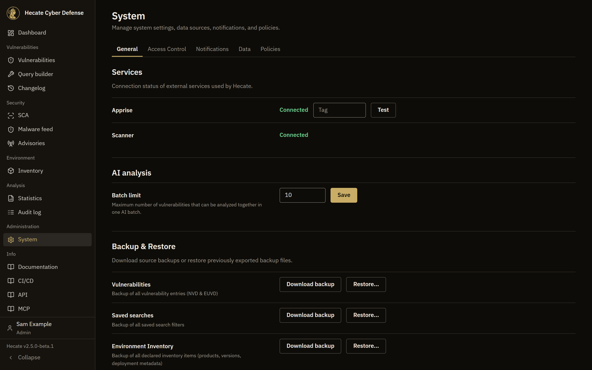
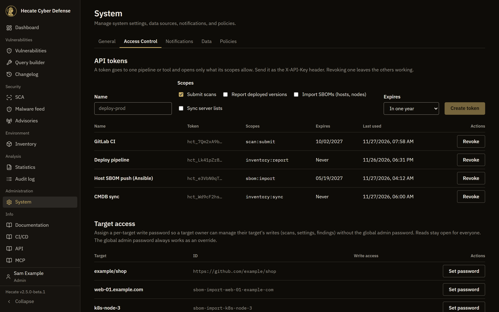
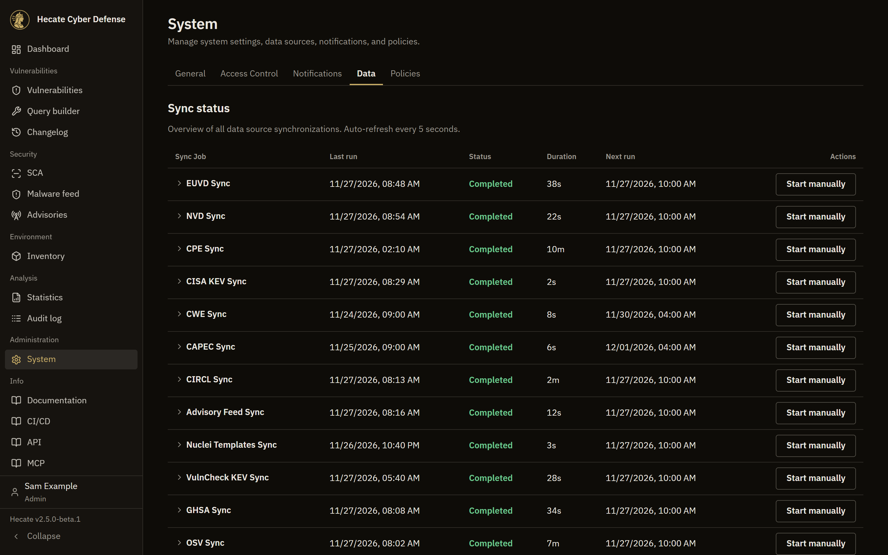
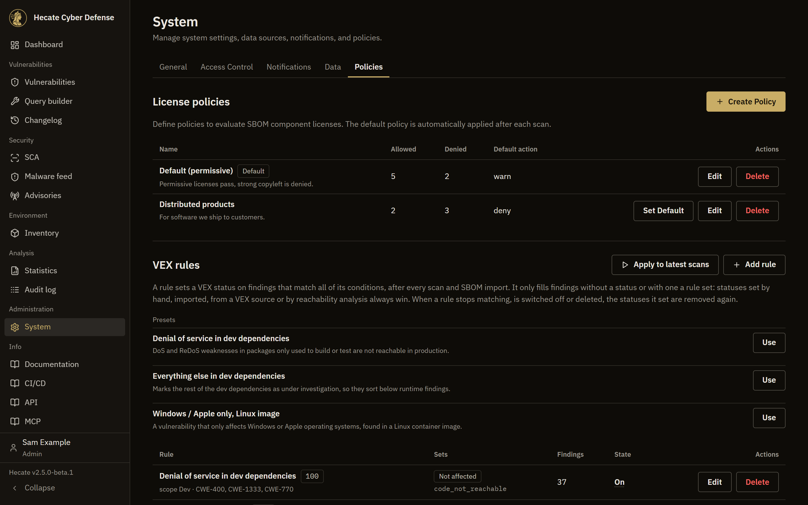

# System Settings

The System page (`/system`) is where you administer the instance rather than investigate a single CVE.
It has five tabs — **General**, **Access Control**, **Notifications**, **Data**, and
**Policies** — covering everything from the interface language to the health of the nine ingestion
feeds. If you only ever touch one administrative screen in Hecate, this is it.

Because these tabs hold mutating controls, the whole page can be locked behind a shared admin password.
When `SYSTEM_PASSWORD` is set, opening `/system` first shows an unlock dialog; enter the password (or
press Escape to back out) and the page appears. The password you type is remembered for the session so
that protected writes elsewhere in the UI — deleting a scan target, saving a notification rule — no
longer prompt you again. With no `SYSTEM_PASSWORD` configured, the page opens directly. See
[Security & Access Control](../security-access-control.md) for how the gate works end to end.

With [OIDC sign-in](authentication.md) configured, a signed-in **admin** opens the page without the
dialog. Anyone else signed in sees the password dialog when a system password exists (so whoever
holds it can still use it), or otherwise an **Admins only** notice with **Sign in**; the page itself
does not load. See [Permissions](permissions.md).

## The five tabs at a glance

Each tab groups a distinct administrative concern. The heavier tabs have their own dedicated pages,
linked in the last column.

| Tab | What you do here | More detail |
| --- | --- | --- |
| **General** | Cap the AI batch size, check service health, send a test notification, and back up / restore data. Language and timezone are personal, under **Preferences** in the sidebar. | this page |
| **Access Control** | Create and revoke API tokens, and set or clear a per-target write password for each scan target. | [Security & Access Control](../security-access-control.md) |
| **Notifications** | Manage Apprise channels, notification rules, and message templates. | [Notifications](../integrations/notifications.md) |
| **Data** | Watch the sync status of every source, trigger syncs by hand, manage advisory feeds and the server lists Hecate fetches, re-sync or delete specific vulnerabilities, and manage saved searches. | this page, [Fetched lists](../guide/inventory.md#fetched-lists) |
| **Policies** | Define SPDX license policies that are evaluated after every scan, and automatic VEX rules. | [License Compliance](../sca/licenses.md), [VEX rules](#vex-rules) |

## General

The General tab collects the personal and instance-wide preferences that shape how the rest of Hecate
behaves, plus the health checks and data exports you reach for occasionally.

**Language and timezone** are not on this page: they are personal, so everyone sets them under
**Preferences** at the bottom of the sidebar, without admin rights (see
[Preferences & Profile](../guide/preferences.md); signed in, they are kept on the account). Hecate ships in
English and German; the interface language defaults to your browser language. The timezone controls
how *every* timestamp is rendered — it defaults to your browser's timezone, and you can type or pick
any IANA zone (for example `Europe/Vienna`). **Use browser default** clears an explicit choice.

!!! note
    Timezone matters for more than cosmetics. The dashboard's day view and the calendar-day
    drill-downs compute their day boundaries against the timezone you set, so picking the right
    zone keeps "today" aligned with your local midnight rather than UTC.

**AI Analysis** exposes a single tunable: the batch limit, the maximum number of vulnerabilities that
can be sent together in one AI batch analysis. Enter a whole number between 1 and 100 and click
**Save**. This is an instance-wide setting (stored on the backend), so it changes the cap for everyone
using the AI Analysis page.

**Services** shows the live connection status of the two external services Hecate talks to — Apprise
(notifications) and the scanner sidecar. Each renders a coloured badge: *Connected*, *Unreachable*, or
*Disabled*. Next to the Apprise badge is a small tag field and a **Test** button that fires a single
test notification through the matching channel, so you can confirm delivery without waiting for a real
event.

**Backup & Restore** lets you export and re-import three datasets — Vulnerabilities (NVD & EUVD),
Saved Searches, and Environment Inventory — as JSON files. Each row has a **Download backup** button
(it streams the file straight to your browser) and a **Restore…** button that opens a file picker.
Restores are upsert-by-ID: entries that already exist are overwritten in place and unknown entries are
inserted, so an export → edit → restore round trip never creates duplicates. The restore validates the
file's metadata before touching anything and reports how many rows were inserted, updated, and skipped.

## Access Control

**API tokens** come first on this tab: each goes to one pipeline or tool and opens only what its scopes allow. A new token is shown once. This part needs `SYSTEM_PASSWORD` or a signed-in admin, see [API tokens](../security-access-control.md#api-tokens).

Below that, the tab manages **per-target write passwords**. Hecate's write
protection has two layers: a global admin password that can authorise any mutation, and an optional
per-target password that authorises writes scoped to one scan target (rescans, settings, VEX edits; deleting the target or its scans still takes the system password).
Here you set or clear that per-target secret for each registered target. The admin password always
overrides a per-target password, so this tab is about delegating narrow write access — for example,
letting one team manage their own target without handing out the admin password.

The full model — how the two layers interact, what the `🔒` badge means on a target, and the
environment variables involved — lives in [Security & Access Control](../security-access-control.md).

## Notifications

The Notifications tab manages the three building blocks of Hecate's alerting: **channels** (Apprise
URLs that say *where* a message goes, each carrying a routing tag), **rules** (that say *when* to fire
— on system events, saved-search matches, vendor/product/DQL matches, scan results, inventory hits,
inventory systems that report new findings, stop reporting or are retired, or retroactive malware alerts), and **message templates** (that customise the title and body per event
type using `{placeholder}` variables and `{#each}…{/each}` loops).

Channels, rules, and templates each have an add button, an inline editor, and a list with edit/delete
actions; rules additionally show a clickable status to enable or disable them and a "last
triggered" timestamp. Because this is a substantial subsystem in its own right, the complete reference —
channel URL formats, every rule type and its parameters, and the full template variable catalogue — is
on the [Notifications](../integrations/notifications.md) page.

## Data

The Data tab is the operational cockpit for Hecate's ingestion. It shows you, at a glance, whether the
intelligence feeding the platform is fresh, and gives you the controls to repair or re-pull specific
records when something looks wrong.

**Advisory feeds** and **Server lists** sit on this tab too. Advisory feeds are the CERT, vendor and
community feeds behind the [Advisories](../guide/cert.md) page (adding one is described in the
[dashboard guide](../guide/dashboard.md)). Server lists are the lists of servers Hecate fetches on a
schedule for the inventory's systems: a URL, a format, *Keep* or *Retire*, an interval and an optional
credential, with **Preview** and **Fetch now**. Both are admin-only; see
[Fetched lists](../guide/inventory.md#fetched-lists).

### Sync status

The **Sync Status** table lists every ingestion job — the regular and initial-sync variants of EUVD,
NVD, CPE, CISA KEV, CWE, CAPEC, CIRCL, CERT feeds, Nuclei templates, VulnCheck KEV (only with a token),
GHSA, and OSV — with one row each. For every job you see its
status (Idle, Running, Completed, or Failed, colour-coded), when it last started and finished, how
long it took, and when it is next scheduled to run. Initial syncs show "Only on startup" in the
*Next Run* column because they have no recurring schedule. The table auto-refreshes every few seconds
and reacts immediately to live job events, so you can watch a running sync progress without reloading.

A running NVD, EUVD, OSV or CPE sync shows how far it is under its status: the number of records
processed so far, and for an initial (full) NVD or EUVD sync a bar with the share of the source's
total. The count updates live as the pipeline reports progress, every 500 records or once a minute.
An incremental run gets the count only, because the source's total says nothing about how many
records changed since the last run.

Each row carries a **Start manually** button that kicks off that job out of band — handy after a feed
outage, or to force an initial bootstrap. Click a row to expand its details: a successful run shows its
last result as formatted JSON, and a failed run shows the error text in red. A few jobs (such as the
MAL enrichment backfill) are CLI-only and display "CLI only" instead of a trigger button, since they
are run from the command line rather than the scheduler.

!!! tip
    The regular sync of a source runs on its own schedule (every 10–120 minutes for most feeds), so
    you rarely need the manual trigger in day-to-day use. Reach for **Start manually** when you have
    just brought the stack up, recovered from an upstream outage, or want to confirm a fix immediately.

### Vulnerability re-sync

Below the status table, **Vulnerability Re-Sync** is the surgical tool for fixing individual records.
Paste one or more identifiers into the textarea — one per line or comma-separated — and Hecate will
delete those documents from both MongoDB and OpenSearch. You can mix CVE, GHSA, OSV, and other IDs, and
you can use wildcard patterns such as `CVE-2024-*` to match a whole range at once (up to 1000 records).

Two buttons control what happens next. **Delete & Re-Sync** removes the matched documents and then
re-fetches them fresh from their upstream sources — the usual choice when a record has drifted or
carries stale data. **Delete Only** (styled in red) removes the documents without re-fetching, for
records you want gone entirely. Either way, Hecate reports how many entries were deleted and refreshed,
and surfaces any per-ID errors. Because both actions are mutations, they go through the write gate
described under [Security & Access Control](../security-access-control.md).

!!! warning
    Wildcard re-syncs are powerful: a pattern like `CVE-2024-*` can match a very large number of
    records. Re-syncing re-pulls each one from upstream, which takes time and hits external APIs, so
    scope the pattern as narrowly as the problem allows.

### Saved searches

The bottom of the Data tab lists all saved searches — the named filters you create on the
Vulnerabilities page. Each row shows its query parameters or DQL query and its creation date, with
inline **Edit** (rename, adjust the query) and **Delete** actions. This is purely a management view;
you create and run saved searches from the [Search & Query Builder](../guide/search.md).

## Policies

The Policies tab manages **license policies** — the allow/deny lists of SPDX license IDs that Hecate
evaluates against every SBOM component after a scan. You define which licenses are explicitly allowed,
which are denied, and a default action (allow, warn, or deny) for anything unlisted, then mark one
policy as the default that runs automatically after each scan.

The editor includes quick-fill buttons that populate the allowed or denied fields from built-in SPDX
groups (permissive, copyleft, weak copyleft), so you can start from a sensible baseline. For how
policies are evaluated, what the verdicts mean, and where the results appear in scan detail, see
[License Compliance](../sca/licenses.md).

### VEX rules

Below the license policies, **VEX rules** set a VEX status on findings automatically, so the same judgement
does not have to be typed again for every target and every scan. A typical use is the noise that dependency
scanners are known for: a regular-expression DoS in a test framework, or a Windows-only vulnerability in a Linux
image.

A rule has **conditions**, all optional and combined with AND; an unset condition matches everything, and a rule
needs at least one:

| Condition | Matches |
| --- | --- |
| Target | a wildcard (`*`, `?`) on the target id or name, case-insensitive |
| Application group | the target's group |
| Target type | container image, source repository, SBOM import |
| Dependency scope | runtime, optional, dev, unknown (see [Dependency scope](../sca/scan-results.md#dependency-scope)) |
| CWE ids | any of the listed CWEs on the vulnerability, read from Hecate's vulnerability database |
| Packages | wildcards on the package name, several separated by commas (`linux-libc-dev, kernel-headers`) |
| Ecosystems | purl types such as `npm`, `pypi`, `maven`, `golang`, `deb` (from the SBOM component, else the scanner's package type) |
| Severity at or below | the finding's severity is at most this one; a finding of unknown severity never matches |
| Distribution ships no fix | the distribution decided not to fix it (*won't fix*), deferred the fix, or the release is *end of life*; from Trivy and Grype. When scanners disagree, one that has a fix wins, so every row of a finding is judged alike. |
| Rejected CVE | the CVE's record in Hecate says REJECTED |
| Windows / Apple OS only, Linux image | see below |

and an **action**: a VEX status, a justification from the CycloneDX or OpenVEX vocabulary (for example
`code_not_reachable`, `requires_environment`, `vulnerable_code_not_in_execute_path`), a detail text and,
optionally, **also dismiss** the finding. Rules run in **priority** order (lower first, then oldest); the first
rule that matches a finding sets its status.

**When rules run.** After every scan (behind the carry-forward from the previous scan and the target's VEX
sources), at the end of an SBOM import, after a target's VEX sources were fetched, when a rule is created,
changed, switched on or off, or deleted, and on **Apply to latest scans**, which goes through the latest completed
scan of every target and reports how many statuses it set and cleared. Rules work on the latest scan; older scans
keep the statuses they had.

**Malicious packages are never judged.** A finding for a malicious package (an advisory id starting with
`MAL-`) is left alone by every rule, whatever its scope or package: such a package has to be removed, not
assessed. A status a rule set on one earlier is taken back on the next run.

**Who wins.** A rule only fills findings that have **no VEX status or one a rule set** (`vexUpdatedBy` =
`vex-rule:<id>`). A status set by hand, through MCP, imported with **Import VEX**, carried forward from a manual
one, applied from a VEX source or set by a reachability analysis is never touched, and a VEX source replaces a
rule's status (a statement about this product beats a generic rule). A rule's dismissal only touches findings
nobody dismissed by hand. When a finding no longer matches its rule, or the rule is switched off or deleted,
the status and dismissal it set are removed again, and only those still carrying its actor; carry-forward keeps
the rule as the actor of both the status and the dismissal, so the next scan can re-check it. On the scan page such a status carries a **rule: name**
chip that links here, and the **Set by → Rule** filter finds them.

**Windows / Apple OS only, Linux image.** This condition matches only when it can be shown from the data and
fails closed otherwise. The vulnerability must have CPE configurations, and *every* configuration must be
restricted to Windows or an Apple OS: either its vulnerable CPEs are themselves `cpe:2.3:o:microsoft:windows*`,
`o:apple:macos` / `mac_os_x` / `mac_os` or `o:apple:iphone_os` / `ipados`, or it has a non-vulnerable
"running on" node made only of such OS CPEs next to an explicitly vulnerable one. A configuration without an
explicitly vulnerable match, with a negated node, or whose platform node also allows another OS (Linux, Android,
anything else) makes the whole vulnerability not match. The target must be a **container image** whose latest
SBOM contains Linux distribution packages (purl type `deb`, `apk`, `rpm` or `alpm`); a source repository, an
SBOM import or an image without such packages never matches.

**Presets.** Ready-made rules can be copied into the form with **Use**; they start switched off:

| Preset | Conditions | Sets |
| --- | --- | --- |
| DoS and ReDoS in dev dependencies | scope dev, CWE-400, 405, 407, 674, 770, 776, 834, 835, 1050, 1333 | not affected, `code_not_reachable` |
| Dev dependencies to triage | scope dev (priority 900, so it runs after more specific rules) | under investigation |
| Windows and Apple OS vulnerabilities in Linux images | container image, Windows / Apple OS only | not affected, `requires_environment` |
| Linux kernel headers in container images | container image, packages `linux-libc-dev`, `kernel-headers`, `linux-headers`, `linux-headers-*` | not affected, `code_not_present`: a container runs on the host's kernel |
| Rejected CVEs | the CVE is rejected | not affected |
| Package managers in runtime images | container image, packages `pip`, `setuptools`, `wheel`, `npm`, `corepack`, `yarn` (priority 800) | under investigation |
| OS packages the distribution won't fix | container image, won't fix / fix deferred / end of life (priority 850) | under investigation |
| Low and negligible OS package findings in images | container image, ecosystems `deb`, `apk`, `rpm`, severity at most low (priority 950) | under investigation |

The *under investigation* presets hide nothing: they sort findings apart, so the **VEX → No status** filter
shows what still needs a look. A per-language preset is rarely needed: development and test dependencies are
recognised per ecosystem ([Dependency scope](../sca/scan-results.md#dependency-scope)), and Go findings get
their status from the [reachability analysis](../sca-scanning.md#go-reachability-govulncheck).

The rules live in the `vex_rules` collection; the routes are `GET/POST /api/v1/vex-rules`,
`PUT/DELETE /api/v1/vex-rules/{id}`, `GET /api/v1/vex-rules/presets` and `POST /api/v1/vex-rules/apply`. Reading
them is open, every write goes through the same admin write gate as the license policies.
