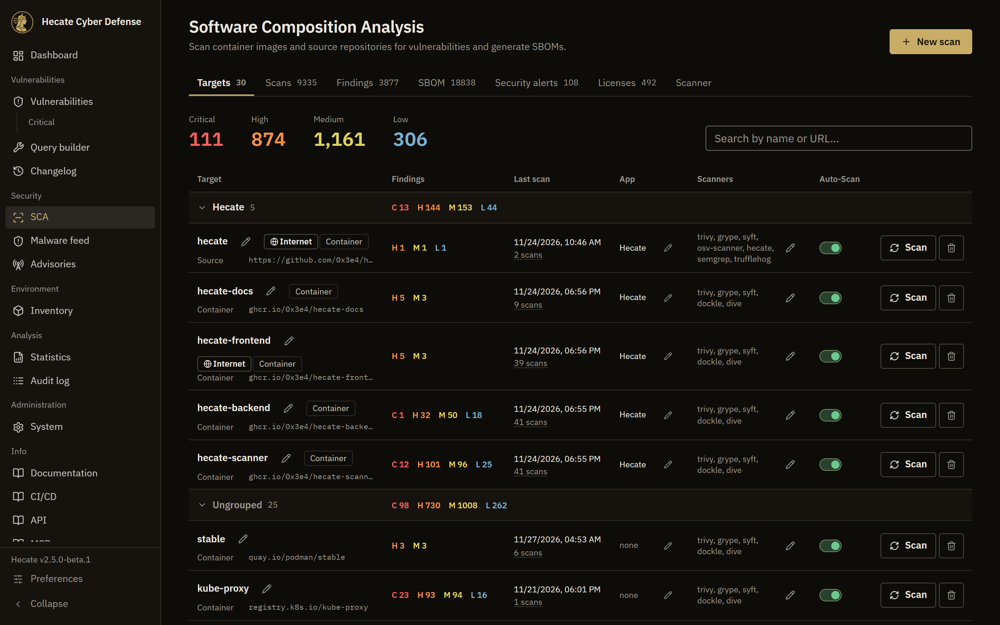

# Getting Started

Hecate ships as a Docker Compose stack: backend (FastAPI), frontend (React/Vite), scanner
sidecar, MongoDB, OpenSearch, and an optional Apprise notification sidecar.

## Prerequisites

- Docker and Docker Compose
- ~4 GB RAM free for OpenSearch + MongoDB (more for large initial syncs)

## Quick start

```bash
# 1. Copy the example compose + env files
cp docker-compose.yml.example docker-compose.yml
cp .env.example .env

# 2. Review .env — at minimum set timezone (TZ) and, for a shared/live
#    instance, a SYSTEM_PASSWORD (see Security & Access Control).

# 3. Start the stack
docker compose up -d

# 4. Open the UI
#    http://localhost:8080  (or whatever you mapped the frontend to)
```

The backend begins ingesting feeds on a schedule immediately. Initial syncs (NVD, EUVD, OSV)
take a while — the UI is usable as data streams in.

## First steps in the UI

Once the UI loads, the [User Guide](guide/overview.md) walks through every page in detail. The quickest
way to get oriented:



1. **Dashboard** — a live "Today" view of newly published CVEs.
2. **Vulnerabilities** — search with the Keyword / DQL / Regex mode pill.
3. **SCA Scans** — register a target (container image or repo) and run a scan. The target
   card title links to a per-target overview page (see [SCA Scanning](sca-scanning.md)).
4. **Inventory** — declare the products/versions you run to get "affected in your environment"
   callouts.
5. **System** — language, timezone, notifications, data sync, license policies, and (if you set
   `SYSTEM_PASSWORD`) **Target Access** for per-target write delegation.

## Reverse proxy & TLS

For anything beyond a local trial, put Hecate behind a TLS-terminating reverse proxy. The
`deploy/reverse-proxy/` folder ships ready-to-adapt templates for **nginx**, **Caddy**, and
**Traefik** that terminate HTTPS, route `/api`, `/mcp` and the SSE stream to the backend and
everything else to the frontend, and set a hardened HTTP security-header set (HSTS, a strict
Content-Security-Policy, `X-Frame-Options`, `X-Content-Type-Options`, `Referrer-Policy`,
`Permissions-Policy`, and the cross-origin isolation headers).

Copy the template for your proxy, replace the placeholder domain and upstream hostnames, and
reload. Pair it with scoped `CORS_ORIGINS` and, on a shared instance, a `SYSTEM_PASSWORD`
(see [Security & Access Control](security-access-control.md)).

## Updating

Images are published to GHCR (`ghcr.io/0x3e4/hecate-{backend,frontend,scanner}` — the namespace is
configurable via `HECATE_GHCR_OWNER`, default `0x3e4`). Pull the
newest and recreate:

```bash
docker compose pull && docker compose up -d
```

The in-app **Support** page compares your running build SHA against the latest published image.

### Rebuilding the search index

Most updates need nothing beyond the pull above. Occasionally a release adds a field the search index
has to compute per record — [affected-version search](guide/search.md#searching-by-the-version-you-run)
is the current example. Records ingested or refreshed after the update get it automatically; to backfill
everything already stored, run once:

```bash
docker compose exec backend python -m app.cli reindex-opensearch
```

It reads from MongoDB, so nothing is lost if you skip or interrupt it — search simply keeps returning
results from whatever has been indexed so far. Expect it to take a while on a large corpus. AI
assessments and attack-path narratives of vulnerabilities exist only in the index; the reindex keeps
them on every record it rewrites.

If the backend logs `opensearch.ensure_mappings_failed` with *cannot change object mapping from
non-nested to nested*, the index predates a field type Hecate now needs, and a reindex cannot change
that. Check the two fields (this assumes the default index name and the bundled OpenSearch):

```bash
docker compose exec -T opensearch sh -c 'curl -sk -u "$OPENSEARCH_USERNAME:$OPENSEARCH_PASSWORD" https://localhost:9200/hecate-vulnerabilities/_mapping' \
  | python3 -c "import json,sys; p=list(json.load(sys.stdin).values())[0]['mappings']['properties']; print({k: p.get(k,{}).get('type','object') for k in ('impactedProducts','versionRanges')})"
```

If `versionRanges` shows `object` instead of `nested`, affected-version search cannot work and the
index has to be created again. Stop the backend first: a running backend would recreate the deleted
index on its next write, without the mapping.

```bash
docker compose stop backend
docker compose exec -T opensearch sh -c 'curl -sk -u "$OPENSEARCH_USERNAME:$OPENSEARCH_PASSWORD" -X DELETE https://localhost:9200/hecate-vulnerabilities'
docker compose run --rm backend python -m app.cli reindex-opensearch
```

The reindex creates the index with the current mapping before it writes. Once it prints
`Reindexing N vulnerabilities`, `docker compose start backend` can run alongside it. Deleting the
index removes the AI assessments and attack-path narratives of vulnerabilities, since MongoDB has no
copy of them; scan analyses are unaffected.

### Shrinking the change history

Before the compact history format, every change-history entry held a full copy of its record and of
the raw upstream data, which made the `vulnerabilities` collection several times larger than its
content. Old entries shrink on their own as records change. To shrink them all at once and give the
space back to the disk:

```bash
# see what it would save, then run it; --pause 0.5 leaves IO for other services
docker compose exec backend python -m app.cli compact-history --dry-run --limit 5000
docker compose exec backend python -m app.cli compact-history --pause 0.5

# afterwards, so WiredTiger returns the freed space
docker compose exec mongo mongosh hecate --eval 'db.runCommand({compact: "vulnerabilities"})'
```

The run reads the whole collection once, so start it at a quiet time. It prints the last document id
with every batch; `--start-after <id>` resumes from there.
