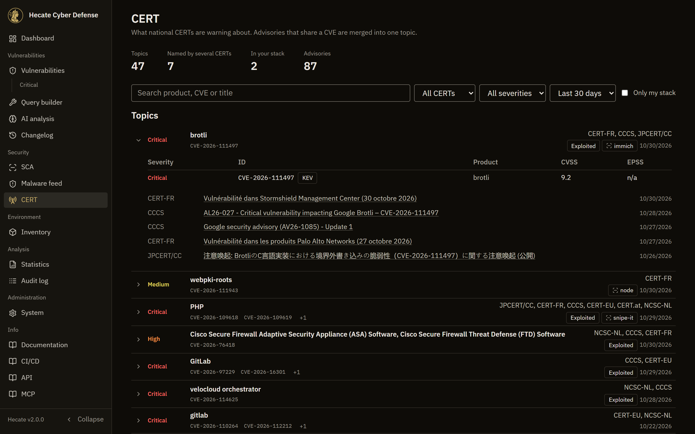

# CERT advisories

The **CERT** page (`/cert`, sidebar group **Security**) shows what national CERTs are warning about, in one list. Hecate reads their public feeds, and advisories that share a CVE are merged into one topic, so the same flaw reported by three CERTs is one row and not three.

Where the dashboard's [Needs attention](dashboard.md#needs-attention) panel answers *what should I look at now*, this page is the full picture behind it.

## Topics

A topic is every advisory connected through a shared CVE. If one CERT names two CVEs of a flaw and another names only the second, both end up in the same topic.

Each row shows:

- the worst severity among its CVEs
- the affected products and the first CVE IDs, taken from Hecate's own data because the feeds' titles come in several languages
- the CERTs that reported it, and the date of the newest advisory
- an **Exploited** tag if any of its CVEs is known to be exploited
- the same inventory and scan tags as on the dashboard

Click a row to fold it open. It lists every CVE with its severity, product, CVSS and EPSS, marks recent KEV listings, and links to each advisory in its original language. A CVE a CERT named before Hecate ingested it reads *Not in Hecate yet*.

Topics that touch your stack come first, then those most CERTs agree on, then by severity and date. "Your stack" here means confirmed: an inventory match from the [version-aware matcher](inventory.md#how-matching-works) or a finding in your latest scans. A package that only shares a product's name shows a tag but does not move the row up.

## Filters

Search covers products, vendors, CVE IDs and advisory titles. You can also narrow the list to one CERT, one severity or **Only my stack**, and pick the last 7, 30 or 90 days; the page remembers that choice.

Feeds only offer their latest entries, so history builds up from the day Hecate starts reading them. A 90-day view fills in over time.

## Round-ups

An advisory that names 20 or more CVEs, such as a Linux distribution's kernel batch or a browser release, is listed under **Round-ups** and not merged. Otherwise a single shared CVE would tie unrelated topics together. Each entry links to the advisory, shows its size, and tells you how many of its CVEs are findings in your latest scans.

## Where the data comes from

The feeds, how to add your own CERT with `CERT_FEEDS_EXTRA` and which CERTs are left out are described under [CERT feeds](dashboard.md#cert-feeds). Advisories that name no CVE, in the feed or on their page, cannot be matched to anything and do not appear here.

The same data is available from `GET /api/v1/stats/cert-advisories?days=30&tz=Europe/Vienna`.
