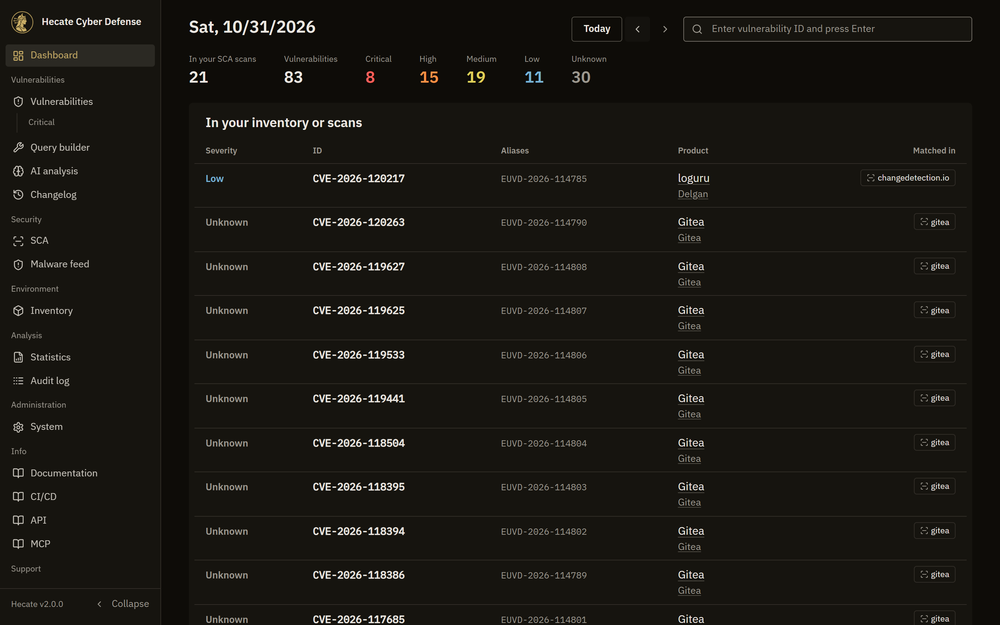

# Dashboard

The Dashboard is what you land on at `/` — the at-a-glance home of Hecate. It answers the
questions you have most mornings: *what is being exploited right now,* *what got published today
that touches my stack,* and *what is the latest thing the feeds have brought in?* It also gives you the fastest possible path to a single
record: type an ID, press Enter, and you are on its detail page.

Nothing here needs a password, and nothing here is destructive. The page reads from the same
normalised vulnerability index the rest of Hecate uses, refreshes itself live as new data is
ingested, and links onward into the parts of the app where you do deeper work — the full
[Vulnerabilities](vulnerabilities.md) list and [Search & Query Builder](search.md).



## Quick ID lookup

At the very top sits a single text box: *Enter vulnerability ID and press Enter.* Type any
identifier Hecate understands — a CVE (`CVE-2024-3094`), a GitHub advisory (`GHSA-…`), an OSV
malicious-package ID (`MAL-…`), a Python advisory (`PYSEC-…`), an ENISA ID (`EUVD-…`) — and hit
Enter. The input is trimmed and upper-cased for you, so case and stray whitespace never matter.

If the record exists locally, Hecate jumps straight to its detail page (resolving to the canonical
ID along the way, so looking up a GHSA that maps to a CVE lands you on the CVE). A small spinner and
a *Searching local database…* line show while the lookup runs, and the `×` button clears the box.

If the ID is **not** in the local database, a notice below the box offers to fetch it for you — see
[Fetching a missing ID](#fetching-a-missing-id) below.

!!! tip
    The lookup is for jumping to one known record. To search by keyword, vendor, product, severity,
    DQL or regex, use the [Vulnerabilities list](vulnerabilities.md) or the
    [Query Builder](search.md) instead.

### Fetching a missing ID

When a lookup misses, Hecate doesn't just shrug — it can pull the record on demand. The notice
explains that the vulnerability hasn't been synchronised yet and offers a **Load from
NVD/EUVD/GHSA** button (with a **Cancel** alongside).

Clicking it dispatches a one-off refresh for that single identifier against the upstream sources.
CVE-prefixed IDs are looked up by CVE number; everything else is resolved by its source ID. The
request runs in the background — you'll see a *Synchronizing "…" from upstream sources…* toast and a
spinner while it works. When the sync completes, Hecate navigates you to the freshly imported
record's detail page automatically. If none of NVD, EUVD or GHSA has the identifier, you get an
error toast explaining that it couldn't be found.

This is the same per-ID refresh mechanism the [detail page](vulnerabilities.md) exposes; the
Dashboard simply offers it at the point where you discover something is missing.

## Needs attention

The *Needs attention* panel shows what is being exploited or warned about right now. A CVE appears
here when, in the last seven days, it was added to CISA's Known Exploited Vulnerabilities catalogue
or at least two national CERTs named it. A CVE that only one CERT named appears when it is also in
your stack. The panel goes by those dates, not by publication: most of these are older CVEs, and a
day view would never show them. It therefore stays the same when you step back through days, and it
still appears on a day with no new CVEs.

Anything confirmed in your [inventory](inventory.md) or in a package of your latest scans comes
first and carries the same clickable tag as elsewhere on the page. The rest is ordered by how many
signals it has, then by the newest listing. Each row shows the severity, the CVE and the product, and
says why it is there: the CERTs that named it, each linking to its advisory, the day CISA listed it,
and a **Ransomware** tag where CISA records known ransomware use. Hover the KEV date for CISA's
remediation due date. **KEV listings** opens the catalogue additions in the
[Vulnerabilities](vulnerabilities.md) view.

The panel reloads whenever new data is ingested, and it is not shown when nothing qualifies.

### CERT feeds

Hecate reads the public advisory feeds of CERT-FR, CERT-EU, NCSC-NL, the Canadian Centre for Cyber
Security and JPCERT/CC every two hours. To add your own national CERT, set `CERT_FEEDS_EXTRA` to
comma-separated `Name|URL` pairs. Any RSS, RDF or Atom feed works:

```bash
CERT_FEEDS_EXTRA=CERT.at|https://www.cert.at/cert-at.de.warnings.rss_2.0.xml
```

Use the feed's final URL, because redirects are not followed. `CERT_FEEDS` replaces the built-in list,
`CERT_FEEDS_ENABLED=false` turns the job off, and **System → Data** shows the last run, including any
feed that failed.

If a feed item names no CVE, Hecate reads the advisory's page once, on the feed's own host. A feed
that publishes neither is stored without CVEs and adds nothing: BSI's CERT-Bund feed is one of these,
which is why it is not in the list. CISA's advisory feed is absent because it refuses Hecate's client;
its KEV catalogue arrives as usual.

## Today's summary

Below the header is a snapshot of the vulnerabilities **published** within the selected calendar
day. A row of figures shows the total and the count per severity, and three lists further down break
that total down so you can see at a glance who and what is affected:

| List | What it shows |
| --- | --- |
| **Vendors** | The vendors named in the day's CVEs, each with a count |
| **Products** | The affected products (with their vendor), each with a count |
| **CVEs by severity** | Every CVE of the day, grouped under Critical / High / Medium / Low / Unknown headers that fold open |

Every entry is a link. Clicking a vendor or product opens the Vulnerabilities list pre-filtered to
that vendor (or vendor + product) **for that day**, expressed as a DQL query so you can refine it
further. Clicking a severity figure in the top row opens the list filtered to that severity for the
day, and clicking any individual CVE jumps straight to its detail page. Each CVE row also shows its known
aliases (GHSA, MAL, and so on) next to the primary ID.

### In your inventory or scans

Beside *Needs attention* sits the list of the day's CVEs that touch your stack, **one row per
product**: you patch a package once, however many CVEs that closes. A row shows the worst severity,
the product and its vendor, where it matched, and a count per severity such as `5 H 3 M 3 L`. Click
it to unfold the individual CVEs. A product with a single CVE links straight to that CVE. Products
are ordered by worst severity, inventory matches first within a severity; the first eight show and
the rest fold away.

If you maintain an [Environment Inventory](inventory.md), the page cross-references it using
the same version-aware matcher as the Inventory page itself: vendors, products, and CVEs confirmed to
affect an entry you declared (not just a name match) are marked with an **"in inventory"** tag and
floated to the top of their lists, and a figure in the top row tells you how many of the day's CVEs
affect your inventory. With no inventory configured, the page looks unchanged. Because the lists
refresh live as new CVEs arrive, newly published inventory-relevant issues highlight as soon as they
land.

The same widgets also cross-reference your **SCA scans** (the latest completed scan of each target): a
today-item is tagged with the **scan target's name** and floated up when it's a package in your
latest SBOMs or a CVE your scans found — so a brand-new CVE for a package you actually run stands out even
if your last scan predates it. Both tags are **clickable**: the "in inventory" tag opens the
[Inventory](inventory.md) page, and the SCA tag opens the most-recent [scan](../sca/scan-results.md) (for
the named target) that covers the item.

The day boundary is **timezone-aware**: "today" begins at local midnight in the timezone you set
under **System → General**, not at UTC midnight. This matters near midnight, where a UTC-based view
would briefly show the wrong day. Arrows beside the header let you step back to previous days
(`‹` / `›`), and a **Today** button returns you to the current day. If a day has no newly published
CVEs, the page shows only the date navigator and *Needs attention*.

!!! note
    The day view counts vulnerabilities by their **publication** date, so a CVE that existed
    locally for a while but was only formally published today still appears here. For long-run
    trends and the full CVSS / EPSS distribution across the whole index, see
    [Statistics & Changelog](statistics.md).

## Latest findings

The bottom of the page is the live feed: the ten most recently ingested vulnerabilities, one line
each, with the severity, ID, product, vendor, CVSS, EPSS and publication time. Known-exploited CVEs
are tinted and carry an **Exploited** tag. Clicking a row opens the detail page, which holds
everything else: aliases, CWEs, affected versions, the assigner and the links to CVE.org, NVD, CIRCL
and the other sources. Product and vendor names link to the list filtered on them, the **copy**
button puts the IDs, severity, vendors, products, versions and summary on your clipboard, and **All
vulnerabilities** opens the full [list](vulnerabilities.md).

### Live auto-refresh

The feed keeps itself current. Hecate streams ingestion progress over Server-Sent Events, and the
Dashboard listens for `new_vulnerabilities` events — whenever a pipeline finishes importing fresh
records, the *Latest Findings* list reloads on its own. You'll see a quiet *Refreshing results…*
line while it does, and you never need to reload the page to see what just arrived.

## Where to go next

The Dashboard is a starting point, not a workbench. When you want to search the whole index, filter
by vendor or severity, or build a precise query, move to the
[Vulnerabilities list](vulnerabilities.md) and the [Search & Query Builder](search.md). To turn the
day's findings into ongoing alerts, set up a watch rule under
[System Settings](../admin/system.md).
