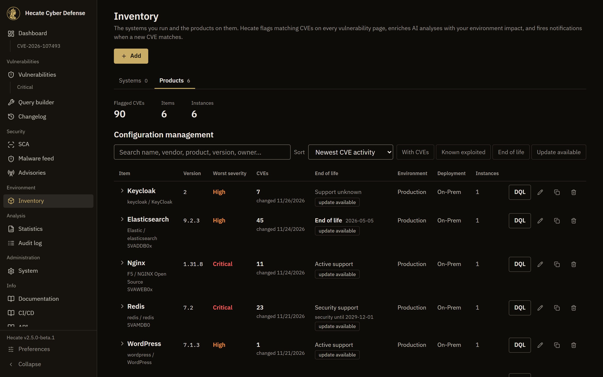
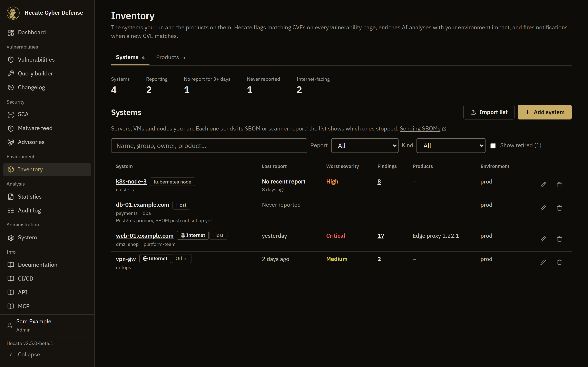
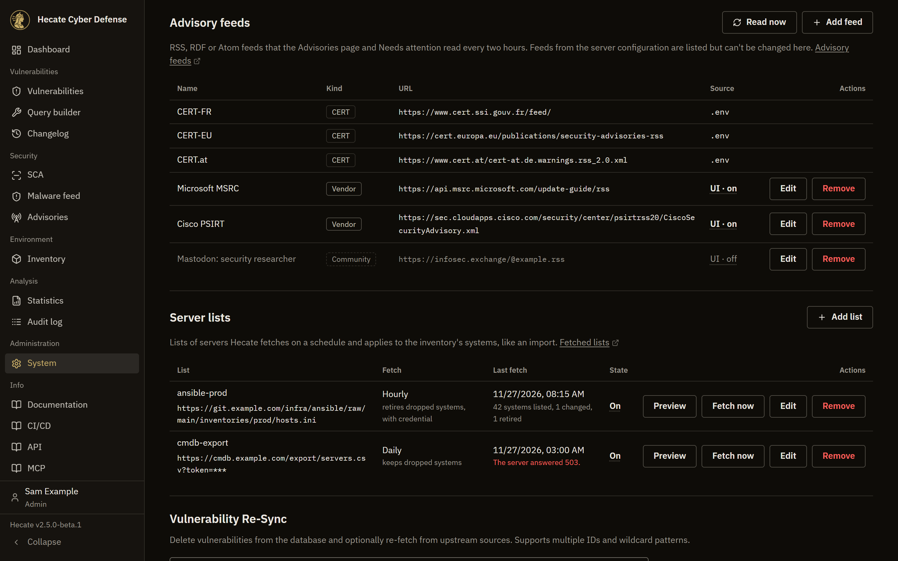

# Environment Inventory

Most vulnerability feeds tell you what *exists* in the world; the inventory tells Hecate what *you actually run*. On this page you declare the products and versions deployed in your environment — ".NET 8.0.25 on the prod cluster", "nginx 1.24.0 on staging", and so on — and Hecate continuously checks each entry against the vulnerability index. The point is to turn a firehose of CVEs into a short, personal list: *these* are the ones that touch software you operate, at the exact versions you run.

What makes this more than a keyword filter is the version matching. Hecate doesn't just look for CVEs that mention your product; it evaluates whether the version you declared falls inside each advisory's affected range. If you run version 8.0.25 and a CVE affects everything from 8.0.0 up to but not including 8.0.26, Hecate marks it as affecting you — and if the next minor release fixes it, your entry stops matching automatically as soon as you bump the version.

Once an entry matches, the result surfaces in several places at once: an expandable list of affecting CVEs on the inventory row itself, a **Flagged CVEs** table rolling up every match across all your entries, a red "Affected in your environment" callout on the matching vulnerability detail pages, an environment-impact block injected into AI analyses, and an optional notification rule that alerts you when a newly published CVE touches your inventory. Each entry is also annotated with its **support / end-of-life status** from [endoflife.date](https://endoflife.date).

The page has two tabs. **Systems** lists the servers, VMs and nodes you run and whether each one still
sends its SBOM; **Products** holds the products and versions described below.



## Systems

A system is a place: a server, a VM, a Kubernetes node, a gateway. What is installed on it arrives as an
SBOM or scanner report that the system pushes ([Hosts, Nodes & Other Systems](../sca/hosts.md)); the
system keeps its latest findings and its history from those pushes.



Systems get onto the list in three ways:

- **By hand**, with **Add system**: the name (use the one the host sends as `targetName`, usually the
  FQDN), what it is (host, Kubernetes node, container, other), whether the internet reaches it, the
  environment, an owner, groups such as a cluster, a site or a team, and notes. A system entered this way
  says *Never reported* until its first push arrives, and then picks it up on its own.
- **By its first push**: an SBOM or report sent with a `kind` creates the system. A push without `kind` (an
  application's SBOM, a vendor's product) stays an SCA target instead.
- **From a server list**: an Ansible inventory, a CSV or a plain list of names, imported on the tab, sent
  by a script ([Server lists](#server-lists)) or fetched by Hecate on a schedule ([Fetched lists](#fetched-lists)).

Names are unique regardless of case, so `WEB-01` and `web-01` are one system.

Each row shows when the last report arrived and what it found:

| Report | Meaning |
| --- | --- |
| *today*, *yesterday*, *5 days ago* | The system reports. |
| **No recent report** | The last report is older than three days (`INVENTORY_SYSTEM_STALE_DAYS`): the push stopped, or the host is gone. |
| *Never reported* | Nothing has arrived yet. |

The list starts with the gaps (no recent report, then never reported), then internet-facing systems, then
the ones with the most critical and high findings. The figures above it count the systems in each state.
An [Inventory system notification rule](../integrations/notifications.md#inventory-system-rules) tells you
when a system stops reporting, when a report brings new findings, or when a server list retires systems.
The name opens the system's findings, SBOM and history; the number of findings opens its latest report.

What a system is and whether the internet reaches it is kept in step with its findings: changing it here or
on the target page changes both, and *Affected in your scans* on a vulnerability page lists internet-facing
systems first.

Removing a system takes it off the list. Its findings and history stay and appear under **SCA → Targets**
again; remove them there if they should go too. The SCA target list leaves systems out, with a pointer to
this tab.

### Server lists

Most fleets already have a list somewhere: an Ansible inventory, a CMDB export, a spreadsheet. **Import
list** on the Systems tab reads it, shows what would change, and applies it. A script can send the same
list on a schedule, so the inventory follows the fleet without anyone editing it.

| Format | What it looks like |
| --- | --- |
| CSV | A header row with `name` (or `host`, `hostname`, `fqdn`) and any of `kind`, `exposure`, `environment` (`env`), `owner`, `groups` (separated by `;` or `|`), `notes`. |
| One name per line | Plain text; `#` starts a comment. |
| Ansible INI | `[group]` sections, `[group:children]`, `[group:vars]`, ranges such as `web[01:20].example.com`. |
| Ansible YAML | `all:` with `hosts`, `children` and `vars`. |
| `ansible-inventory --list` | The JSON Ansible prints for any inventory, dynamic inventory plugins included. |
| Hecate JSON | `{"systems": [{"name": "web-01", "kind": "host", "groups": ["dmz"]}]}`; the `systems` of an inventory backup read the same way. |

The format is detected; pick it in the dialog (or send `format`) when the detection guesses wrong.

In the Ansible formats a system's groups are the groups it is in, parents included (`all` and
`ungrouped` are left out), and these variables set its fields, on a host or on a group for all of its hosts
(the host's own value wins):

```ini
[web]
web[01:03].example.com hecate_exposure=internet

[prod:children]
web

[prod:vars]
hecate_kind=host
hecate_environment=prod
hecate_owner=platform-team
```

`hecate_kind` (`host`, `kubernetes-node`, `container`, `other`), `hecate_exposure` (`internet`,
`internal`), `hecate_environment`, `hecate_owner` and `hecate_notes`. A value that isn't one of these is
left out and listed in the preview.

What a list sets wins over what the system had: it is the record someone keeps. Groups are replaced when
the list names any. The **list name** (for example `ansible-prod` or `cmdb`) decides what *Replace*
affects:

- **Keep them** (`merge`) adds new systems and updates the ones it names. Nothing is removed.
- **Retire them** (`replace`) also retires the systems this list named last time and no longer does. A
  retired system stays with its history and is hidden unless **Show retired** is ticked; it comes back as
  soon as a list names it again or it pushes an SBOM. Only systems that no list names any more are
  retired: a system on two lists stays while the other one keeps it, and systems added by hand or by a
  push are never retired by a list.

A *Replace* that would retire more than half of the systems the list named is refused (`409`): an empty
export from a broken script would otherwise retire the fleet. Check the list, or send `force=true` (in
the dialog: **Apply anyway**). **Preview** (`dryRun`) shows the outcome without changing anything.

A list naming a system that already pushed an SBOM links the two right away.

#### Sending a list from a script

Create an API token with the scope **Sync server lists** (`inventory:sync`) on **System → Access
Control**. It opens these two endpoints and nothing else:

```bash
# the file itself
curl -fsS -X POST -H "X-API-Key: $HECATE_TOKEN" -F "file=@inventory/prod.ini" \
  "https://hecate.example.com/api/v1/inventory/systems/import/upload?source=ansible-prod&mode=replace"

# any Ansible inventory, plugins included, through ansible-inventory
ansible-inventory -i inventory/ --list > /tmp/inventory.json
curl -fsS -X POST -H "X-API-Key: $HECATE_TOKEN" -F "file=@/tmp/inventory.json" \
  "https://hecate.example.com/api/v1/inventory/systems/import/upload?source=ansible-prod&mode=replace"
```

`POST /api/v1/inventory/systems/import` takes the same as JSON: `content` (the list as text), `format`,
`source`, `mode`, `dryRun`, `force`. From Ansible, send the file: a JSON string in a `uri` body is turned
back into data on the way. The answer counts what was added, changed, retired and brought back,
and lists what was left out and why.

With Ansible, one play can keep both sides current: the list from the control node, and each host's own
SBOM ([Hosts, Nodes & Other Systems](../sca/hosts.md)) named after `inventory_hostname`, so the two meet:

```yaml
- name: Server list to Hecate
  hosts: localhost
  gather_facts: false
  tasks:
    - name: Export the inventory
      ansible.builtin.command: >-
        ansible-inventory -i {{ ansible_inventory_sources | join(' -i ') }}
        --list --output /tmp/hecate-inventory.json
      changed_when: false
    - name: Send it
      ansible.builtin.command: >-
        curl -fsS -X POST -H "X-API-Key: {{ hecate_sync_token }}" -F file=@/tmp/hecate-inventory.json
        "https://hecate.example.com/api/v1/inventory/systems/import/upload?source=ansible-prod&mode=replace"
      changed_when: false
      no_log: true  # keeps the token out of the play's output

- name: SBOMs to Hecate
  hosts: all
  tasks:
    - name: Build the SBOM
      ansible.builtin.command: >-
        syft scan dir:/ --exclude './proc/**' --exclude './sys/**' --exclude './dev/**'
        -o cyclonedx-json=/var/tmp/sbom.cdx.json
      changed_when: false
    - name: Send it
      ansible.builtin.command: >-
        curl -fsS -X POST -H "X-API-Key: {{ hecate_sbom_token }}" -F file=@/var/tmp/sbom.cdx.json
        "https://hecate.example.com/api/v1/scans/import-sbom/upload?targetName={{ inventory_hostname }}"
      changed_when: false
      no_log: true
```

Hecate never runs a script itself: the list is produced where the inventory and its credentials live.

### Fetched lists



When the list is already published somewhere (a CMDB export, NetBox, an AWX inventory, a file on an
internal web server), Hecate can fetch it itself. **System → Data → Server lists** takes a list name,
a URL, the format (or *Detect*), what happens to systems the list no longer names (*Keep them* or
*Retire them*, as above) and how often to fetch it: every 15 minutes up to weekly. A new list is
fetched within a few minutes.

Each fetch is applied exactly like an import under the list's name, so a fetched list and a pushed one
with the same name are one list: a script can stop pushing and Hecate takes over. **Preview** fetches
and shows what would change without changing anything; **Fetch now** applies it at once.

A fetch that fails applies nothing and leaves the systems as they are: an unreachable server, an
answer that is not a list, or a *Retire* that would retire more than half of the list's systems. The
row shows why, the next fetch tries again, and the first failure in a row lands in the audit log and
sends a *sync failed* notification. After the half-of-the-list refusal, **Apply anyway** applies that
answer once.

A list behind a login takes a credential: a header name (`Authorization` by default, or e.g.
`X-API-Key`) and its value, such as `Token 0123…` for NetBox or `Bearer …` for AWX. It is only sent
over https, stored on the server and never shown again; leave the field empty to keep it.

The backend makes these requests, so only admins manage server lists, and the URL is held to the same
rules as advisory feeds:

- http or https, no `user:password@` in the URL (use the credential field), no control characters, no redirects (give the
  final URL), at most 5 MB, UTF-8 text;
- every address the host resolves to must be public, checked when the list is saved and before every
  fetch. Lists on the internal network, which is where most CMDBs live, need
  `INVENTORY_LIST_SOURCES_ALLOW_PRIVATE_HOSTS=true` on the backend.

Only the systems parsed from the answer reach the inventory; the answer itself is never shown.
Removing a server list stops fetching it and retires nothing. Server lists are not part of the
inventory backup.

| Variable | Default | |
| --- | --- | --- |
| `INVENTORY_LIST_SOURCES_ALLOW_PRIVATE_HOSTS` | `false` | Allow lists on private, loopback or link-local addresses. |
| `INVENTORY_LIST_SOURCE_TIMEOUT_SECONDS` | `30` | Timeout of one fetch. |
| `SCHEDULER_INVENTORY_LIST_SOURCES_CHECK_MINUTES` | `5` | How often Hecate looks for lists whose interval has passed. |

### Products on a system

A product can name the systems it runs on (**Runs on** in the product dialog). The product row then says
*on web-01, web-02*, and the system lists its products. The link is a description, not a match: a product's
CVEs come from its own version, a system's findings from its own report.

### Systems through an assistant

The MCP server lists, adds, changes and removes systems, addressed by id or by name, so an assistant can
answer "which internet-facing hosts stopped reporting?" or "add db-02 to the vienna group". It can also
apply a server list pasted into the chat: that tool shows what would change first and applies only when
asked again. Server lists Hecate fetches itself are managed in the web UI only. The tools are listed in
[MCP Server](../integrations/mcp.md#read-tools-vs-write-tools).

## Finding the right product

The catalog holds about 240,000 products, and popular names come with many look-alikes: searching for `wordpress` matches around 1,700 plugins and themes. Results are ranked by how well they fit, so the exact name comes first, then names starting with the term, then names containing it as a word. Each result shows the number of known vulnerabilities, which tells apart entries that read the same, such as `WordPress` and `WordPress Foundation`.

You can search the product first. Hecate then fills in the most likely vendor, and you can still change it.

## Adding, editing and deleting entries

The page is reached from the sidebar under the **Environment** group. It has a short summary at the top (with chips showing how many items and total instances you have declared), **Configuration management** — a compact list, one row per entry — and **Flagged CVEs**, a single table rolling up every distinct CVE that affects any of your entries.

To create an entry, click the **Add** button in the top-right of the **Configuration management** header; a dialog opens with the form. Fill it in and press **Create**. To change an existing entry, click **Edit** on its card; the same dialog re-populates with the current values, and **Save** writes the changes back. Close the dialog with **Cancel**, the **✕** in its corner, the **Escape** key, or by clicking outside it. **Duplicate** opens the same dialog filled with an entry's values, including its endoflife.date link, for a second server or environment of the same product; change what differs and press **Create**. **Delete** removes an entry (a dialog asks first). Because the version is part of the match, the normal way to keep the inventory accurate is simply to edit the version field whenever you upgrade — there is no separate "mark as fixed" step.

The form fields are:

| Field | Required | Notes |
| --- | --- | --- |
| **Name** | yes | A free-text label for your own benefit, e.g. ".NET 8.0.25 — prod cluster". |
| **Vendor** | yes | Auto-completes from Hecate's asset catalogue. Type to search; aliases are shown beneath each suggestion. |
| **Product** | yes | Also from the catalogue. Disabled until a vendor is chosen, and re-filters to that vendor's products. |
| **Version** | yes | An exact version (`8.0.25`) or a wildcard (`8.0.*`, which expands to "anything in the 8.0 line"). |
| **Deployment** | — | A chip choice of **On-Prem**, **Cloud** or **Hybrid**. |
| **Environment** | — | Free text with suggestions (`prod`, `staging`, `dev`, `test`, `dr`); you can type your own. |
| **Instance Count** | — | How many instances you run (minimum 1). Feeds the "total instances potentially affected" figure used in AI prompts and notifications. |
| **Owner / Team** | — | Optional owning team, e.g. `platform-team`. |
| **End-of-life tracking** | — | The [endoflife.date](https://endoflife.date) product used for the support / EOL status. Auto-detected from the product name; change it to pick a different product, or clear it to unlink. Hidden when EOL tracking is disabled on the server. |
| **Notes** | — | Optional free-text notes. |

Picking the vendor and product from the catalogue rather than typing them by hand matters: it ensures the entry uses the same normalised vendor/product identifiers Hecate stores on vulnerability records, which is what lets the matcher line your entry up against the right advisories.

!!! tip
    Use the search box above the inventory list to filter the rows by any field — name, vendor, product, version, environment, owner or notes. It is a quick local filter, so it responds as you type.

## How matching works

You don't configure matching — it runs automatically against every advisory in the index. In plain terms, for each inventory entry Hecate finds the vulnerabilities recorded against that vendor and product, then decides, version by version, whether the version you declared is actually in scope. It does this in three tiers, and the first tier that says anything about your product's *versions* decides:

1. **Curated affected-version ranges.** If an advisory carries explicit affected-version data (for example "`>= 8.0.0, < 8.0.26`"), Hecate parses it and checks whether your version falls inside. This is the most precise source, so it wins when present — and "your version is *not* in the range" counts as a definite *no match*, it does not fall through to a looser tier. An entry that names your product without any usable version (an empty list, `*`, `n/a`) says nothing about versions and leaves the decision to the next tier.
2. **Structured NVD configuration ranges.** When the curated data is absent, Hecate evaluates NVD's structured version-range configurations the same way, separately for each target platform NVD lists (its Azure Identity SDK entry covers Python, Java and JavaScript under one name). A bare product entry with no version bounds (a "this product, any version" CPE) is treated as carrying *no* version information, so it never matches a specific installed version.
3. **Flat CPE fallback.** Only when neither of the above has version information for your product does Hecate fall back to the plain list of affected product identifiers, and there it requires an exact version match — an unbounded wildcard never counts as a match, to avoid flagging you for a version you don't run.

The [`affectedVersion:` search](search.md#searching-by-the-version-you-run) runs on exactly this decision, so the vulnerability list and the inventory never disagree about a version. Where the tiers contradict each other, the curated one wins: NVD's configuration for some Windows Server CVEs names the *fixed* build as a concrete version, and that no longer flags the fixed build.

In every tier, an entry the advisory marks as **not vulnerable** is skipped. NVD uses those for the platform a vulnerable product runs on ("Next.js before 12.0.5, running on Node.js 15 or later"), so a Node.js or Python entry in your inventory is not flagged for a Next.js or Odoo advisory.

Each tier also reads a product's ranges as a whole, by **release branch**. When the advisory gives your branch its own fix, only that fix decides: for nginx CVE-2026-90439 (`>= 1.29.2, < 1.31.6` and `>= 1.30.4, < 1.30.5`) an entry on 1.30.6 is not affected, one on 1.31.2 is; for Redis CVE-2026-81934 (one `< X` per line) 7.4.12 is not affected by `< 8.10.1`. The branch is the first two version segments; when every fix in the list sits on a different major (Node.js `< 20.18.2`, `< 22.12.1`; .NET 8, 9 and 10), it is the major alone, so Node.js 20.19.0 is past the 20.x fix and not affected. A single `< 3.0` keeps meaning "everything older"; an upper bound counts as a branch fix only next to upper bounds of other branches. When NVD shows one product name for several packages (its Azure Identity SDK entry covers every language), the rule stays off for that product.

A few products carry their **product line** in NVD's data instead of their platform. NVD writes Microsoft Dynamics 365 as one product and names Finance and Operations, Supply Chain Management or Field Service only as the "target software" of its CPE, while the on-premises server has none. Hecate keeps those apart: an advisory for one line only reaches inventory entries for that line, so a Finance and Operations fix (10.0.x) no longer flags a Dynamics 365 9.1 on-premises entry (CVE-2023-24896, CVE-2023-36800), and advisories without a line still do. An entry for a line uses that line's product, such as `dynamics-365-for-finance-and-operations` (the asset catalogue's spelling); `affectedVersion:` searches split the same way after a reindex.

A pre-release in a CPE counts as one: NVD stores Wazuh 5.0.0 beta 1 as version `5.0.0` with `beta1` in a separate field, and Hecate reads it as `5.0.0-beta1`, so an advisory about the betas does not flag the final 5.0.0. Service packs and updates (`sp2`, `update_45`) come after a release and are left as they are.

A **rejected** CVE (withdrawn by its numbering authority) matches nothing. Hecate recognises the rejection from NVD's status and from the CVE program's wording, which is all EUVD carries.

Throughout, matching is **fail-closed for version-less references**: an "any version" wildcard or an open-ended "from 0 upwards" range carries no usable version evidence, so it is never treated as a match for a specific version. This is what stops an old advisory about a third-party add-on that merely lists your platform as "affected" (with no version) from being reported against the exact release you run — for example, several legacy phpBB module advisories that reference `phpbb` only as a version-less platform tag no longer match a concrete phpBB version.

The version comparison understands dotted version numbers of any size (Windows builds such as `10.0.19045.7807`), pre-release suffixes (so `8.0.25-preview.1` and Python's `12.4.0b1` / `1.2.0rc1` sort before the release), letter releases that come *after* a version (OpenSSL `1.0.2k`, Arista `4.26.9M`), and a leading `v`. When a version string can't be parsed, Hecate falls back to a plain case-insensitive equality check rather than guessing an ordering — a deliberately conservative choice, so you get false negatives rather than false positives.

Feeds don't all write their ranges the same way. Alongside the plain `>= 8.0.0, < 8.0.26` form, a large share of European advisories arrive with a typographic operator and an implied lower bound — `4.7 ≤4.7.30` ("from 4.7 through 4.7.30"), `0 ≤2.4.7` ("everything up to 2.4.7"), `n/a ≤6.8.2` ("up to 6.8.2, lower bound unstated"). Hecate normalises all of these before comparing, so an advisory that covers a whole release line is matched across that line rather than only at its first version. OSV and GitHub write `>=12.0.0 <12.0.5`, with a space between the bounds; that form keeps its upper bound too. A range with no usable bound at all (`*`, `-`, `n/a` on its own) still counts as no information and never matches.

A small number of vendors number releases as an independent build counter per branch rather than one continuous scale — Citrix NetScaler ADC/Gateway is the confirmed example, where a version like `14.1, 66.59` means "branch 14.1, build 66.59". For those vendors, Hecate matches the branch first and only then compares build numbers within it, so a fix threshold on one branch (e.g. "branch 14.1, build < 56.73") can never accidentally cover an installed build on a different branch.

## Keeping versions current

A match is only as good as the version it was checked against, so there are three ways to update one, and all of them are recorded in the history below.

**In the row.** Expand an item and change **Running version**. The field below it takes an optional note for the history, such as a ticket number, the server or the change request. A note also works on its own: leave the version as it is, write the note ("checked on web-01, still 1.22.1") and press **Add note**. When endoflife.date knows a newer release of the same cycle, **Set to** offers it in one click. Hecate never applies that on its own: the inventory states what actually runs, and a version nobody deployed would quietly clear real CVE matches.

**From a pipeline.** After a rollout, `POST /api/v1/inventory/report` records the deployed version. See [CI/CD integration](../integrations/cicd.md#reporting-deployed-versions).

**Through an assistant.** The MCP tool `update_inventory_item` changes an item by id; `change_note` adds the note.

The add/edit dialog has the same **Note for the history** field. The note belongs to that one change: it shows next to the entry in the history and is not stored on the item, so the item's own **Notes** stay as they are. One item holds one version; a product that runs in several versions gets one item per version (Duplicate makes that quick).

## History

Every change is logged with the time, the old and new value, the note if one was given, and how it was made: the web interface, an API report (with the name the pipeline gave), MCP (with the identity), or a backup restore. The expanded row shows the history of that item, and **Recent changes** at the bottom of the page shows all items, including deleted ones. Saving a form without changing anything leaves no entry; a note on its own leaves a *Note* entry.

A note can be corrected afterwards: hover an entry (on a phone the buttons are always shown) and use the pencil; the entry is then marked *edited*, with who and when in its tooltip. The changes an entry records (old and new value, source, time) cannot be edited. The bin removes an entry that should not be there, for example a version reported by mistake. Both need the same rights as editing the inventory, and both land in the [audit log](../admin/audit.md) with the entry's content, so a removed entry is still on record there.

The same log is available over the API: `GET /api/v1/inventory/history` returns recent changes across all items and `GET /api/v1/inventory/{id}/history` one item's log, both with `limit` and `offset`. `PATCH /api/v1/inventory/history/{entryId}` with `{"note": "…"}` corrects a note (empty removes it), `DELETE /api/v1/inventory/history/{entryId}` removes an entry.

## Where matches show up

### On the inventory row

Each row names the severity of its worst current match, so a glance down the list tells you which entries are exposed. The row shows the item name, vendor/product and version, chips for deployment / environment / instance count, the endoflife.date support badge, and a CVE-count pill. **Click the row** to expand an in-line list of the affecting vulnerabilities, sorted by severity and CVSS, each linking straight to its detail page and flagged with a **KEV** chip when CISA lists it as known-exploited. The **DQL** button opens the same set of matches as a pre-built query in the [Vulnerabilities](vulnerabilities.md) list, which is handy when you want to sort, export or filter them with the full search UI. With no current match it opens `vendorSlugs:… AND productSlugs:… AND affectedVersion:"<version>"` instead, which checks the indexed version ranges directly. Edits made in the dialog (including a version bump) refresh the row, its CVEs and the **Flagged CVEs** table immediately — no reload.

### Sorting and filtering the list

Above the list, **Sort** orders the items by:

| Sort | Order |
| --- | --- |
| **Newest CVE activity** (default) | Items whose affecting CVEs changed most recently come first: a new advisory, a new score, a new version range, a KEV listing. Items without any CVE go last. |
| **Worst severity** | Critical first, known-exploited before the rest of a severity, then by number of CVEs. |
| **Most CVEs** | By the number of affecting CVEs. |
| **Support ends soonest** | By the end-of-support date from [endoflife.date](#end-of-life-and-support-status); products it doesn't know go last. |
| **Recently edited** | By your last change to the item. |
| **Name** | Alphabetically. |

Each row shows when its newest affecting CVE last changed. A **new** tag marks rows where that
happened since your previous visit to the page.

The filters narrow the list to one environment, deployment or owner (each appears once your items
use more than one), and the buttons to items **With CVEs**, **Known exploited** CVEs, **End of life**
or an **Update available** within their release line. Sort and filters are remembered in this
browser; **Reset filters** clears them.

### In the Flagged CVEs table

Below the list, the **Flagged CVEs** table is a single roll-up of every distinct CVE affecting *any* of your entries, sorted by severity then CVSS. Each row links to the vulnerability detail page and shows severity, CVSS, EPSS, the publication date, a **KEV** chip for known-exploited issues, and which inventory items it affects (name and version). It's the fastest way to see your whole exposure at once without expanding each card.

### On vulnerability detail pages

When you open a CVE that touches one of your inventory entries, its detail page shows a red-bordered **"Affected in your environment"** callout just below the summary, listing the matching entries (version, deployment, environment, instance count, owner) with a deep link back here. This is the reverse view of the inventory row: from any vulnerability, you can immediately see whether — and where — it lands in your estate. See [Vulnerabilities](vulnerabilities.md) for the rest of the detail page.

### In AI analyses

When you run an AI analysis on a CVE, the inventory match is folded into the prompt as a **"Your environment impact"** block listing the affected entries and the total number of instances at risk, with an instruction for the model to weigh the priority assessment against the versions you actually run. The same context flows into batch analyses and into the MCP `prepare_*` tools, so an assistant reasoning about a CVE knows it matters to you specifically. More on this in [AI Analysis & Attack Paths](ai-analysis.md).

### In notifications

A dedicated **inventory** notification rule type fires when a newly published CVE touches your inventory. You can scope a rule to all entries (the default) or to a chosen subset, so a team can be alerted only about the products they own. Rules are created and managed alongside the other rule types — see [Notifications](../integrations/notifications.md) for channels, templates and the full rule editor. Systems have their own rule type, [Inventory system](../integrations/notifications.md#inventory-system-rules).

## End-of-life and support status

Beyond CVEs, each entry is annotated with its **lifecycle status** from [endoflife.date](https://endoflife.date). Hecate links every item to the matching endoflife.date product automatically (you can override or clear the link in the **End-of-life tracking** field), looks up the release cycle your declared version belongs to, and shows a badge on the card:

- **Active support** — the cycle is still fully maintained.
- **Security support** — active support has ended, but security fixes continue (with the date).
- **End of life** — the cycle is no longer supported (with the date) — a strong signal to upgrade.

The compact badge on the row shows the status, the **support-until date** for your cycle (when active support ends, or when the cycle goes end-of-life), an **LTS** chip for long-term-support cycles, and an **"update available"** hint when you're behind the latest release. **Expand the row** for the full endoflife.date detail above the CVE list — the release cycle and its dates, the **latest release** in that cycle, a **"newer release line"** marker when a newer major line exists (so the inventory doubles as a quick "what's overdue for an upgrade" view), and a **↗ endoflife.date** link to the product's page (e.g. `endoflife.date/rabbitmq`) for the full release table. The lookup is best-effort and cached, so a temporary endoflife.date outage never blocks the page — the badge simply doesn't appear. An administrator can disable the whole feature server-side (see [Environment Variables](../configuration.md)).

## Backup and restore

The inventory is included in Hecate's backup tooling. Under **System → General** you'll find an **Environment Inventory** row with export and upload buttons next to Vulnerabilities and Saved Searches. Exporting downloads every entry and every system as a JSON file, with the links between them; restoring upserts by ID, so re-importing a backup overwrites entries that still exist and re-creates ones that were deleted, without producing duplicates. This makes the round trip — export, edit elsewhere, restore — safe to repeat. Backups made before systems existed restore as before. A backup holds the systems, not their findings: those stay with the scans.
