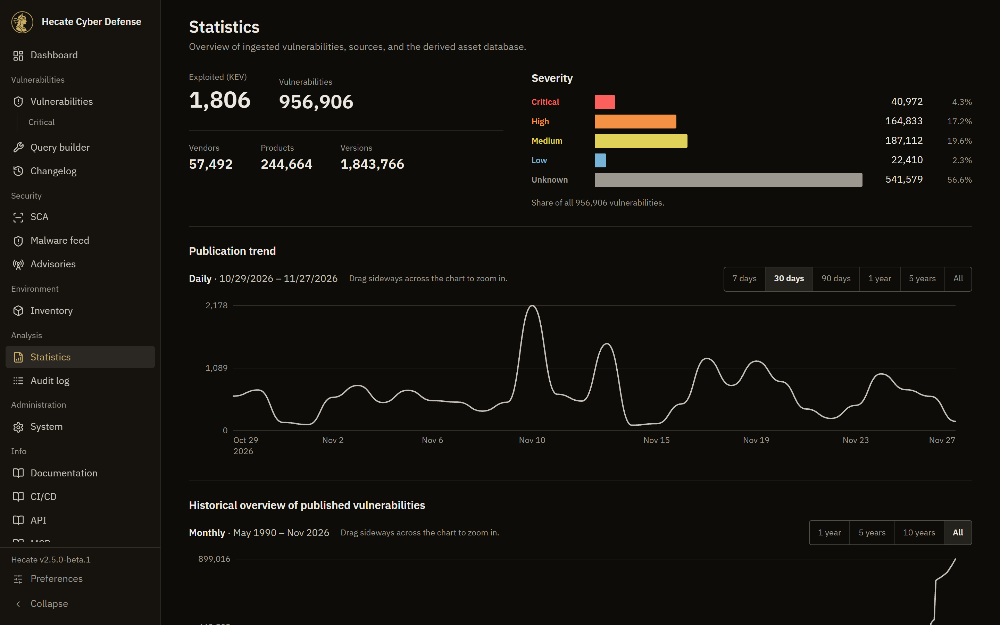
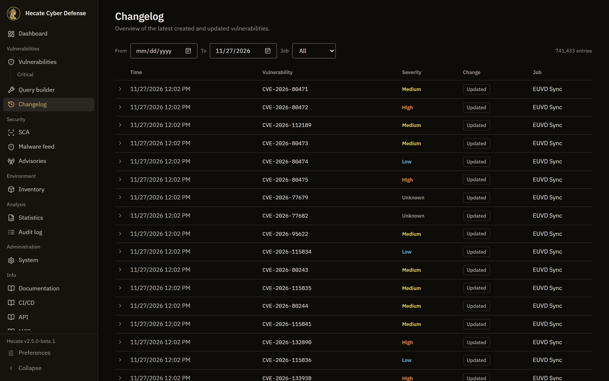

# Statistics & Changelog

Two read-only pages sit at the analytical edge of Hecate. **Statistics** (`/stats`) gives you the
shape of the whole index at a glance — how many vulnerabilities you hold, where they came from, how
they break down by severity and exploit probability, and which weaknesses, vendors and products
dominate. The **Changelog** (`/changelog`) is the opposite zoom level: a live, paginated feed of
*what actually changed* in each ingestion pass, entry by entry, so you can watch the database grow
and see exactly which fields a feed touched on any given CVE.

Neither page lets you mutate anything; both are about understanding. Use Statistics to answer "what
does our coverage look like overall?" and the Changelog to answer "what did the last few syncs bring
in, and which source wrote it?"

!!! note "Two different changelogs"
    The page described here is the **in-app data changelog** — a record of vulnerability records
    being created and updated as feeds run. It is not the **release changelog** that tracks new
    Hecate versions and features; that lives in [Changelog](../changelog.md) on this documentation
    site. They share a name but answer entirely different questions.

## Statistics

The Statistics page loads an overview snapshot of the index and renders it as a summary grid
followed by a column of charts. Everything is computed server-side and refreshed each time you open
the page. There are no filters: the only controls pick the period of the two timelines and open the
vulnerability list for a vendor or product.

### The summary grid

At the top, five tiles give you the headline counts. Vulnerabilities is the total number of records
in the index; **Exploited (KEV)** is the subset that CISA has flagged as known-exploited; and the
last three — **Vendors**, **Products** and **Versions** — count the entries in the asset catalogue
that Hecate derives from CPE data and the affected-product fields across every record. All values are
formatted in your locale, so large numbers carry the thousands separators you expect.

### The charts

Below the grid, the charts move from "where the data comes from" to "what it looks like" to "how it
trends over time". Each renders as an animated bar, line or ranked-list visualisation; hover any bar
or point for an exact count.

| Chart | What it shows |
| --- | --- |
| **Source** | Distribution of records across the ingestion feeds (NVD, EUVD, GHSA, OSV, …), top six by volume |
| **Severity** | Record counts bucketed Critical → High → Medium → Low → Unknown, colour-coded |
| **Top 5 CWEs** | The most frequently assigned weakness types (the `NVD-CWE-noinfo` / `NVD-CWE-Other` placeholders are filtered out) |
| **EPSS Score** | How records spread across exploit-probability bands (0–10 %, 10–30 %, 30–50 %, 50–70 %, 70–100 %), green for low risk through red for high |
| **Publication trend** | A smoothed line of how many CVEs were published per day, week or month; the last 30 days by default, up to the whole history |
| **Historical overview** | A cumulative running total of published vulnerabilities across the whole timeline |
| **Most named vendors / products** | Ranked bar lists of the vendors and products that appear most across the index |
| **Top reference domains / assigners** | Ranked lists of the most common reference hostnames and CNA assigners |

A final pair of cards at the bottom, **Asset vendors** and **Asset products**, ranks the entries of the
derived asset catalogue that the most vulnerabilities name: the top eight show, **Show all 15** opens
the rest. Each row gives the catalogue name, its count and share of all vulnerabilities, and a second
line with what the catalogue knows about it: how many products a vendor has in the catalogue, how
many versions are known for a product and which vendor it belongs to, plus aliases that differ from
the name. Package registries and placeholders such as `npm` or `n/a` are left out of the vendor
ranking, since they don't name a maker.

Select a name to open the vulnerability list filtered on it (for example
`vendorSlugs:"microsoft"` in DQL mode). The ranking counts the same field the filter uses, so the list
shows the number you clicked. Under each list, **Search all vendors** / **Search all products** looks
through the whole catalogue and links every hit the same way.

### Time ranges and zooming

The quick-range buttons above each chart pick a period: the publication trend offers 7 days, 30 days
(its default), 90 days, 1 year, 5 years and **All**; the historical overview 1 year, 5, 10 and **All**
(its default). Drag across either chart, with the mouse or one finger, to zoom into that period, and
drag again inside the zoomed chart to go further in.

The granularity follows the period, so a zoom shows more detail instead of fewer points. Up to about
four months the charts count per day, up to about three years per week, and beyond that per month.
The label in front of the range says which one you're looking at (**Daily**, **Weekly** or
**Monthly**). Zoom from the monthly history into a few months and it switches to weeks, then to days.
While the finer data loads, the chart keeps showing the coarser points dimmed; a period you have
already looked at comes back at once.

The axis rescales to the window, and the cumulative chart keeps its absolute running total: its axis
starts at the number published before the window. **Reset zoom**, Escape or a double-click go back to
the chart's default period. A tap still shows the value of one point, and the arrow keys move through
the points when the chart has focus.

The same data is available as an API: `GET /api/v1/stats/timeline?from=2026-01-01&to=2026-04-01&tz=Europe/Vienna`
returns the buckets (`interval=auto|day|week|month`), the chosen interval and the count published
before `from`. Try it on [hecate.pw](https://hecate.pw/api/v1/stats/timeline?from=2026-01-01&tz=Europe/Vienna).

### Shares

Every bar shows its share in percent, and hovering a bar shows its count and share. A note under each
chart says what the share is of: severity and EPSS split one group, so their shares add up to 100 %;
sources, CWEs, vendors, products and assigners are shares of all vulnerabilities, and since one
vulnerability can name several of them, those don't add up to 100 %.

!!! note "Days follow your timezone"
    The publication trend and historical overview count vulnerabilities per day, week (starting
    Monday) and month in the timezone you set under **Language** in the sidebar, and label them that way, so
    a day on the chart is the same day as on the dashboard's **Today** card. An unknown timezone falls
    back to UTC.

## Changelog (in-app data changes)

The Changelog is a chronological feed of the most recently created and updated vulnerability records.
Every time a feed ingests data, the records it writes carry a change stamp — which job ran, when, and
which fields it altered — and this page surfaces that stamp as a scannable list. It is where you go
to confirm that a sync actually landed, to see what NVD changed about a CVE overnight, or simply to
keep an eye on the flow of new advisories into the database.

Each row shows the vulnerability ID, a **Created** (cyan) or **Updated** (amber) badge reflecting the
latest change, a severity chip in the corner, the title (which links straight to the
[vulnerability detail page](vulnerabilities.md)), the timestamp in your configured timezone, and the
job that made the change. Clicking a row expands it to a field-by-field diff: every field the job
touched, shown as old value versus new value, with object and array values rendered as formatted
JSON. This is the same change-history view you see on a CVE's own detail page, scoped to the single
most recent change.

### Filtering and paging

Three controls sit above the feed. A **From** and **To** date pair narrows the feed to a window —
the *To* field defaults to today, and *From* is open until you set it. A **Job** dropdown filters by
the source that made the change, with options for NVD, EUVD, GHSA, KEV, CIRCL, OSV and deps.dev (the
malicious-package enrichment job), plus **All** to clear it. When a date or source filter is active,
a **Reset** button appears to clear everything back to the default; the total entry count is shown on
the right.

The feed pages in blocks of 50, with **Previous** / **Next** controls and a page indicator below the
list whenever there is more than one page. Changing any filter returns you to the first page.

### Live updates

The Changelog refreshes itself as ingestion happens. It listens for job-completion events over
Server-Sent Events and reloads the current view the moment a sync finishes, so you see new entries
appear without touching the page. Because some reverse proxies (Cloudflare among them) can interrupt
long-lived SSE connections, a 60-second polling fallback runs alongside it — even if the live stream
drops, the feed never goes more than a minute stale.

!!! note "Why a CVE shows up under one source and not another"
    The job shown on each entry is the one that wrote the *latest* change, not every source that has
    ever touched the record. A single CVE enriched by NVD, then EUVD, then CIRCL will appear in the
    feed under whichever job ran most recently. Filter by **Job** to follow one feed's output in
    isolation. For the deeper mechanics of how Hecate reconciles the same CVE across feeds, see the
    [Architecture](../architecture.md) reference.
