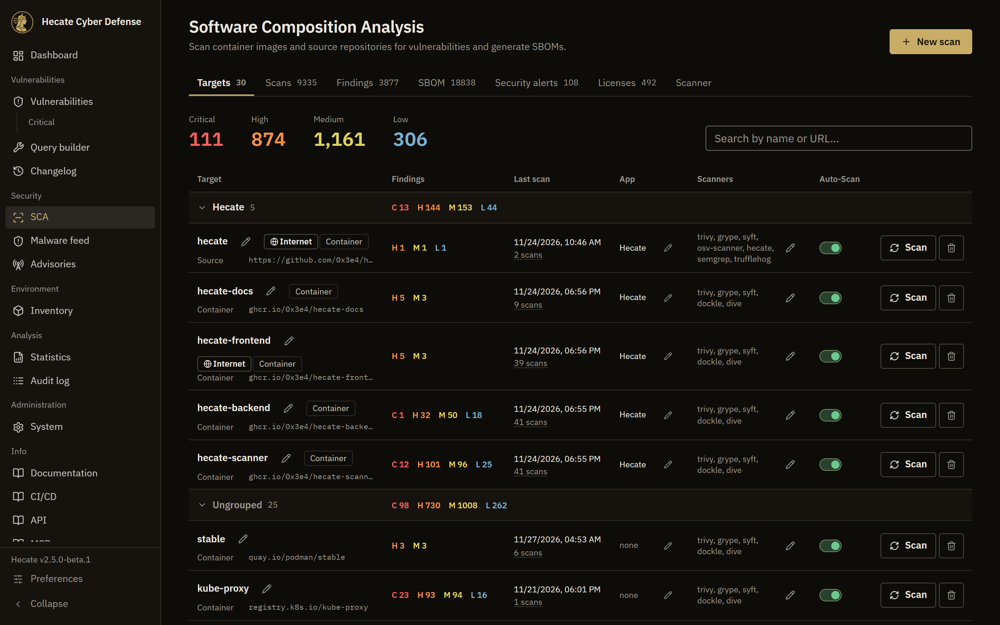

# SCA Scanning

Software Composition Analysis (SCA) is the active half of Hecate. Where the vulnerability index tells
you what exists in the world, SCA tells you what is in *your* software: it scans your container images
and source repositories with ten tools running in a hardened sidecar, then consolidates everything
into one picture — dependency vulnerabilities, a software bill of materials, exposed secrets, static
analysis findings, container best-practice issues, and malicious-package indicators.



This page covers the building blocks: targets, the scanners, auto-scanning and status badges. Once a
scan has run, see [Reading Scan Results](sca/scan-results.md) for how to interpret every tab, and the
dedicated pages for the [Attack Chain](sca/attack-chain.md), [malware detection](sca/malware.md) and
[license compliance](sca/licenses.md).

## Targets

A **target** is a scannable entity identified by a path-like id — a container image reference such as
`ghcr.io/org/app`, or a source-repository URL. Register one on **SCA Scans → Targets**, or simply run
a scan and the target is created for you. Related targets (say the backend repo, the frontend repo and
the worker image of one product) can be grouped into a single **application**, and the Targets tab then
shows each group as a collapsible section with a combined severity roll-up.

A target's name starts out derived from its reference (`hecate-docs` for `ghcr.io/0x3e4/hecate-docs`).
**Rename** on the target page, or the pencil next to the name in the Targets tab, gives it another one.
Only the name changes: the id stays, the target's earlier scans show the new name too, and later scans
keep it. Renaming is a target write, so a write-protected target asks for its password.

Every target also has its own deep-linkable overview page at `/scans/targets/<id>`, reachable by
clicking a target card's title. It gathers the target's metadata, latest severity rollup, auto-scan
diagnostics, full scan history, top findings and quick actions (rescan, run a check, delete) in one
place — and because the URL is stable you can bookmark or share a link straight to it. When a target
is write-protected it shows a 🔒 badge and a **Change password** button: the target's owner can set a
new password or remove the protection with the current one. The first password is set by the admin on
**System → Access Control** (see [Security & Access Control](security-access-control.md)).

The **Scans** tab lists every run, newest first, and filters by target and by status (pending,
running, completed, failed, cancelled), so failed or cancelled runs are one click away.

A scan that can no longer finish is cancelled on its own. Scans run inside the backend process, so
a scan that was queued or running when Hecate restarted is cancelled at startup, and every five
minutes a watchdog cancels a scan that lost its task or ran past its maximum runtime
(`SCA_SCAN_MAX_RUNTIME_SECONDS`; by default derived from the selected scanners' timeouts, about 90
minutes). The scan's error says why, and the target stops showing a scan in progress.

Servers, VMs, workstations and Kubernetes nodes push their own SBOMs instead, and appliances go into
the inventory: see [hosts, nodes and other systems](sca/hosts.md).

## Checks

A **check** scans something once without registering it as a target: an image or repository you want
to look at before adopting it, a ZIP of code that is not pushed yet, or an SBOM a supplier sent you.
It runs the same scanners and shows a **check report** at `/scans/check/<scan id>`: the severity
summary, the affected packages, other findings (malware indicators, secrets, SAST, best practices),
an overview of the SBOM, and exports (findings as CSV or JSON, the SBOM as CycloneDX or SPDX).

A check stays out of everything else. It appears in no list (Targets, Scans, Findings, SBOM), not on
the dashboard, not in "Affected in your scans" on a vulnerability, and the MAL-* watcher, VEX sources
and VEX rules, notifications and the registry lookups for supply-chain signals all leave it alone.
The report link is the only way back to it, and it is deleted with its findings and SBOM
`SCA_CHECK_RETENTION_DAYS` (default 7) after it was submitted. A check cannot be marked as a release.

Out of the lists is not private: like every scan, a check can be read by anyone who may read scans and
knows its id, and scan ids are not secret tokens. For code that must stay confidential, turn on
[sign-in](admin/authentication.md) with `AUTH_REQUIRE_LOGIN` so reads need a session or a key.

Start one in the **New scan** dialog with **Check only, without a target**; an uploaded ZIP always runs
as a check. For an SBOM, tick **Check only** next to the import. From a pipeline, send `"check": true`
with [`POST /api/v1/scans`](integrations/cicd.md#checks-without-a-target), or `check=true` /
`"check": true` with the SBOM import endpoints; an assistant calls the MCP tool `trigger_scan` with
`check=true`. Since a check writes into no target, a target password
does not open it: it needs the editor role or the system password, or the CI key / a `scan:submit`
token for `POST /api/v1/scans`.

Scans made with the earlier one-time ZIP upload count as checks too: they drop out of the lists, but
have no expiry date and stay until deleted.

## Scanners

Eleven scanners run inside the sidecar. Trivy, Grype and OSV Scanner find dependency vulnerabilities;
govulncheck adds reachability for Go; Syft builds the SBOM; the in-house Hecate Analyzer adds its own
SBOM extractor, malware detection and provenance checks; and the remaining four cover specialised,
opt-in surfaces. Each target remembers the
scanners chosen at its first scan and reuses them for later auto-scans.

| Scanner | Purpose |
| --- | --- |
| trivy, grype, osv-scanner | Vulnerability detection |
| govulncheck | Go only, source repositories: reports a vulnerability only when its vulnerable function is reachable, and marks the other scanners' findings for unreached code VEX `not_affected` ([Go reachability](#go-reachability-govulncheck)) |
| syft | SBOM generation |
| hecate | In-house SBOM extractor + malware detector + provenance |
| dockle | CIS Docker Benchmark, container images (Best Practices tab) |
| dive | Image-layer analysis, container images (Layer Analysis tab) |
| semgrep | SAST for source repositories |
| devskim | Microsoft SAST, strong .NET coverage (shares the SAST tab) |
| trufflehog | Secret scanning for source repositories; verifies each candidate against its provider unless the target or `TRUFFLEHOG_NO_VERIFICATION` turns it off ([secret verification](#secret-verification)) |

In a repository scan the dependency scanners read lockfiles and manifests. SBOM or VEX files committed
to the repository (`*.cdx.json`, `*.spdx.json`, `bom.json`) are not treated as the repository's
dependencies: they usually describe something else, such as the container image built from it. To
check an SBOM, import it as its own target instead. A committed VEX file is not applied either; add
its raw URL as a [VEX source](sca/scan-results.md#vex-sources) on the target.

Where a lockfile or manifest says whether a package is a runtime, optional or development dependency, the Hecate analyzer records it; the findings and SBOM can then be filtered by that [dependency scope](sca/scan-results.md#dependency-scope), and [VEX rules](admin/system.md#vex-rules) can act on it.

The image-only scanners (Dockle, Dive) and the repo-only scanners (govulncheck, Semgrep, DevSkim,
TruffleHog) only produce output for the matching target type. Container images are pulled directly through registry
APIs — no Docker socket is mounted — and Dive uses Skopeo to fetch the image as an archive. Registry
and git credentials are supplied through the `SCANNER_AUTH` environment variable.

For source-repo targets the repository is cloned **once per scan** and the working tree is shared
across all scanners (rather than cloned once per scanner), so a scan no longer fires several
concurrent `git clone` of the same repo that could contend for bandwidth and trip the clone timeout.
The clone budget is `GIT_CLONE_TIMEOUT_SECONDS` (default 300 s); a clone failure surfaces as a single
clean error and marks the scan failed.

## Secret verification

TruffleHog checks each secret it finds by sending it to the provider it belongs to: a login against the
AWS, GitHub, Slack or Stripe API. A secret that works is reported **verified** (critical), one that
doesn't or can't be checked **unverified** (high). That tells you which leaks are still live, but the
secret leaves your network to do it, and some repositories hold credentials that must not: one-time
tokens, or S3 keys for a local Ceph that would be sent to AWS.

So it is set per repository. On the target page, **External lookups** → **TruffleHog secret verification** offers:

| Setting | TruffleHog runs |
| --- | --- |
| Scanner default | as `TRUFFLEHOG_NO_VERIFICATION` on the scanner says (verification on unless it is `true`) |
| Verify found secrets | with verification, whatever the scanner default |
| Don't verify | with `--no-verification`: nothing is sent, every secret is unverified (high) |

Changing it needs the same rights as the target's other settings (admin, editor, or the target's
password) and lands in the
[audit log](admin/audit.md). It applies from the next scan. Checks (scans without a target, uploaded
archives) always use the scanner default. With [no external lookups](#no-external-lookups) on, TruffleHog
never verifies, whatever this setting says.

## No external lookups

Several scanners ask outside services about what they find in your code: a registry about each package
name, OSV.dev about the package list, a provider about a secret. For public code that costs nothing.
For private code it can: internal package and module names, the shape of your dependency tree and found
credentials leave your network. **No external lookups** keeps all of that in.

Turn it on per target: target page → **External lookups** → **No external lookups**. Changing it needs
the same rights as the target's other settings (admin, editor, or the target's password), lands in the
[audit log](admin/audit.md) and applies from the next scan. A scan that ran this way says so in its
header (**Lookups: none outside the network**), so its results read right later. The API field is
`noExternalLookups` on `PATCH /api/v1/scans/targets/{id}`.

### What each scanner does with it

| Scanner | Normally sends out | With no external lookups | What you lose |
| --- | --- | --- | --- |
| **Hecate Analyzer**: provenance | every SBOM package with its version, to its registry (npm, PyPI, sum.golang.org, Maven Central search, RubyGems, crates.io, NuGet, Docker Hub) | not run | the SBOM's provenance column stays *unknown* |
| **Hecate Analyzer**: typosquatting | a dependency name that looks like a popular package, to npm or PyPI (does it exist?) | not asked; an answer cached by an earlier scan is still used | such a candidate is reported with **low** confidence and the note *registry not consulted*, instead of being dropped when the package exists |
| **OSV-Scanner** | the whole package list (names and versions) to `api.osv.dev`; for an unpinned `requirements.txt` line, the package name to PyPI (to find the latest version) | matches against a local copy of the OSV database (`--offline-vulnerabilities --download-offline-databases`); no PyPI lookups | unpinned `requirements.txt` lines are checked at their lowest allowed version, which can add findings; the first scan downloads the database of each ecosystem it finds (npm's is about 220 MB compressed, PyPI's about 40 MB) |
| **TruffleHog** | each found secret to its provider, to check whether it works | `--no-verification`, whatever the target's [secret verification](#secret-verification) says | every secret is *unverified* (high instead of critical) |
| **govulncheck** | module paths to `GOPROXY` (default `proxy.golang.org`) and the checksum database `sum.golang.org` when it downloads modules | `GOPROXY=off`, `GOSUMDB=off`: only modules vendored in the repository (`vendor/`) or already in `GOVULNCHECK_CACHE_DIR` are read | a module whose dependencies are not available that way fails, and gets no reachability VEX |
| **Trivy** | for some dependencies (Java archives Trivy's Java database doesn't know), an API request to identify them | `--offline-scan` (`TRIVY_OFFLINE_SCAN=true`) | such an archive may stay unidentified |
| **Grype**, **Syft** | nothing: their network lookups (Maven Central, remote licenses) are off by default | pinned off, so a configuration file can't turn them on | nothing |
| **Semgrep**, **DevSkim**, **Dockle**, **Dive** | nothing about your code | unchanged | nothing |

After the scan, the backend also stops asking about the target's packages:

| Backend step | Normally asks | With no external lookups |
| --- | --- | --- |
| [Supply-chain signals](#supply-chain-signals) (release age, unmaintained, npm publisher change) | deps.dev, the npm registry and Packagist, per package | not run: no supply-chain chips on the SBOM tab |
| [Bundled native libraries](#bundled-native-libraries) | the npm registry, for the libvips package of the sharp version in the SBOM | not run: no libvips rows and no CVEs for them |

### What still leaves the network

None of it names a package, module path, file or secret of the scanned code:

- **Getting the code**: the clone of the repository or the pull of the image, from wherever you host it.
- **Vulnerability databases**: Trivy, Grype, OSV-Scanner (its local copy) and govulncheck download
  their public databases. OSV-Scanner's download shows which ecosystems the scan found (npm, PyPI, …).
  govulncheck fetches advisories from `vuln.go.dev`, which sees which advisory IDs it fetches; point
  `GOVULNCHECK_DB` at a mirror to keep that inside too.
- **Semgrep rules**: `SEMGREP_RULES` (default `p/security-audit`) is downloaded from semgrep.dev; the
  scanned code is not uploaded. To stay offline, mount your rules into the scanner container and set
  `SEMGREP_RULES` to their path.

### How the databases stay current

The vulnerability data keeps updating; only the matching moves from a query to a local copy.

| Scanner | Its data | Where it is kept |
| --- | --- | --- |
| Trivy | downloads a new database (and Java database) before a scan when the local one is out of date | `TRIVY_CACHE_DIR` |
| Grype | loaded at scanner start and checked for updates at scan time | the `grype-db` volume |
| OSV-Scanner | the database of each ecosystem in the scan, fetched with every scan of such a target and downloaded again only when OSV has published a newer one | the `osv-db` volume (`OSV_SCANNER_LOCAL_DB_CACHE_DIRECTORY`) |
| govulncheck | advisories fetched on every run | – (`GOVULNCHECK_DB` for a mirror) |

OSV.dev rebuilds its exports continuously, so the local copy is as current as the scan that fetched it;
the online query is current to the minute. Without the `osv-db` volume the copy lives on the scanner's
`/tmp` and is downloaded again after a restart.

Hecate's own database (NVD, EUVD, OSV, GHSA, …) is unaffected: it syncs on its schedule, never per target.
What Hecate matches itself (Affected in your scans, findings without a CVE, and the
[MAL-* watcher](sca/malware.md), which checks every new malicious-package record against the stored
SBOMs) works the same for these targets.

### What it does not cover

- **AI analysis** sends the findings to the AI provider you configured, when someone starts one.
- **VEX sources** are fetched from the URLs you entered on the target.
- **Notifications** go to the channels you configured.
- **Checks** (scans without a target, uploaded archives) have no target and always run with the
  scanner defaults. Scan private code through a target to use this setting.

To be sure nothing else gets out, give the scanner container egress only to your Git or registry host
and the database hosts above, and watch what it is refused.

## Go reachability (govulncheck)

Trivy, Grype and OSV Scanner compare versions: a Go module in a vulnerable range is a finding, whether
your code ever reaches the vulnerable function or not. **govulncheck** (the Go team's own tool) type-checks
every Go module of the repository (each `go.mod` outside `vendor/`, `testdata/` and directories starting
with `.` or `_`, at most `GOVULNCHECK_MAX_MODULES`, default 25) and answers per Go vulnerability-database
entry on one of three levels:

| Level | Meaning | What Hecate does |
| --- | --- | --- |
| symbol | a vulnerable function is reachable from your code | a govulncheck finding, with the call path in its description |
| package | the vulnerable package is imported, no vulnerable function is called | the other scanners' findings for it get VEX `not_affected`, justification `vulnerable_code_not_in_execute_path` |
| module | the module is required, the vulnerable package is not imported | the same, justification `vulnerable_code_not_present` |

The VEX statements carry the actor `reachability:govulncheck` and show a **reachability** chip next to
the status (the tooltip names the entry and the package). A finding is matched by its CVE, GHSA or GO
id and the module path. The reachability analysis never overwrites a status set by hand, imported, written
over MCP or taken from a VEX source; it does replace a status a VEX rule set (evidence beats a generic rule),
and runs before the VEX rules, which then leave its statements alone. A VEX source replaces its statement. When a later
scan shows the function is called, or no longer reports the entry, its own statement is removed again;
carry-forward keeps the actor. Statements are only set when every Go module was analysed without an error;
a failed module still lets a "called" answer clear a statement. Findings from committed Go binaries are
left alone. Standard-library entries are skipped, because govulncheck judges the standard library by the
Go toolchain inside the scanner image, not by your project's.

govulncheck needs the Go toolchain and the module sources, so the scanner image carries Go and downloads
modules through `GOPROXY` (default `https://proxy.golang.org`, without `direct`: a `require` in the scanned
tree must not make the sidecar fetch from arbitrary hosts). Private modules need an operator-set `GOPROXY`
(and `GONOSUMDB` / `GOPRIVATE`). The vulnerability database is `https://vuln.go.dev`; an offline site
points `GOVULNCHECK_DB` at a mirror (an `https://` or `file://` URL). A `toolchain` line in a scanned
`go.mod` never downloads another Go (`GOTOOLCHAIN=local`), so a module requiring a newer Go than the
image's fails with a clear error. Module downloads land in a per-run directory under `/tmp` (or
`GOVULNCHECK_CACHE_DIR` for a persistent cache). Budget: `GOVULNCHECK_TIMEOUT_SECONDS` (default 600) for
all modules of a scan. govulncheck is opt-in: tick it in the scanner selection of a source-repository scan.

## Supply-chain signals

After every completed scan (and SBOM import) Hecate looks up each registry package of the SBOM (npm,
PyPI, Go, Maven, Cargo, NuGet, RubyGems through [deps.dev](https://deps.dev), Composer through Packagist,
npm publishers through the npm registry) and flags three things on the component:

| Signal | When |
| --- | --- |
| Fresh release | the installed version was published less than `SCA_FRESH_RELEASE_DAYS` (default 7) days ago. Worms like Shai-Hulud spread through new releases from taken-over accounts and most are pulled within days, so a short cooldown catches them. |
| New publisher | npm only: the npm account that published the installed version published none of the `SCA_PUBLISHER_HISTORY` (3) versions before it. Maintainers added since the previous version are listed too. Checked for versions at most `SCA_PUBLISHER_CHECK_MAX_AGE_DAYS` (365) old. A switch to trusted publishing from CI also shows up here. |
| Unmaintained | the package's latest release is older than `SCA_UNMAINTAINED_DAYS` (default 730) days. |

The SBOM tab shows them as chips under the component name and as a **Supply chain** facet to filter by;
the scan header counts them once the lookups finished. The CycloneDX export carries them as
`hecate:release:*` / `hecate:npm:*` properties. Lookups run in the background behind the scan (at most
`SCA_RELEASE_INFO_MAX_COMPONENTS` components, `SCA_RELEASE_INFO_CONCURRENCY` at a time,
`SCA_RELEASE_INFO_TIMEOUT_SECONDS` in total), are cached per package version in the `package_releases`
collection for `SCA_RELEASE_INFO_CACHE_TTL_HOURS` (24; unknown packages 6), and never fail a scan.
Two answers change with the next publish and are kept for 15 minutes only: which version is the latest
(an unpinned check) and "this version is not published yet", so a release published minutes ago is
flagged by the package check and by the next scan. Only
npm account names are stored, no e-mail addresses. `SCA_RELEASE_INFO_ENABLED=false` turns the lookups
(and the release part of the [package check](integrations/package-check.md)) off.

## Bundled native libraries

Some npm packages ship compiled libraries instead of code: sharp's `@img/sharp-libvips-<platform>`
packages contain libvips and about 25 libraries it links (libheif, libxml2, libexpat, libpng, libtiff,
libwebp, librsvg, cairo, freetype, glib, ...). No lockfile or manifest names them, so the scanners only
see the npm package, and a CVE in libxml2 or libheif reaches nobody.

When the SBOM of a scan or an SBOM import contains a sharp-libvips package, Hecate downloads that release
once from the npm registry, checks it against the registry's sha512 integrity, reads the
`versions.json` the package carries and adds each library as its own SBOM row: type `library`, a
`pkg:generic/<name>@<version>` purl, a CPE, and **bundled in** naming the package it came in. The
libraries are matched against the vulnerability database like an inventory entry, by the CPE vendor and
product the advisories are filed under, so a library only gets CVEs of that library (a project of the
same name from another vendor never matches). Those findings carry the scanner `bundled-libraries`;
the fix is an update of the package that pulls the library in (`sharp`).

The platform variants of one release ship the same libraries, so a release is read once and cached in
`package_releases` for 30 days (a failed download 6 hours). The download is capped at
`SCA_BUNDLED_LIBRARIES_MAX_DOWNLOAD_MB` (64), the whole lookup at
`SCA_BUNDLED_LIBRARIES_TIMEOUT_SECONDS` (90); a failure costs these rows, never the scan. A library a
scanner already listed is not added twice. The CycloneDX export carries the carrier as the
`hecate:bundledIn` property. `SCA_BUNDLED_LIBRARIES_ENABLED=false` turns it off; set
`SCA_BUNDLED_LIBRARIES_REGISTRY_URL` to a registry mirror when the backend cannot reach
registry.npmjs.org. Only sharp-libvips is recognised so far.

## Auto-scan

With `SCA_AUTO_SCAN_ENABLED=true`, the scheduler periodically probes each `autoScan` target through the
sidecar `/check` endpoint, comparing the current image digest or commit SHA against the stored
fingerprint, and only launches a full scan when something actually changed. Every probe writes its
outcome back onto the target — the last check time, the verdict, the current fingerprint, and the
underlying error string if the probe failed — and the **Scanner** tab surfaces all of this in a
per-target diagnostics table. The verdict pill is clickable, so you can re-probe a single target on
demand without waiting for the next cycle.

## Status badges

Hecate publishes shields.io-compatible badge endpoints that need no authentication. One renders the
severity summary for a specific scan; the other auto-resolves to a target's latest completed scan, so a
README badge always tracks the newest run. Wrap the shields.io image in a link to the target's detail
page to make the badge clickable:

```markdown
[](https://<host>/scans/targets/<id>)
```

`<id>` is the path-encoded target id (for example `https%3A%2F%2Fgithub.com%2Forg%2Frepo`), encoded
once more inside the shields.io `?url=` parameter. The target detail page's **Copy badge** button
produces exactly this linked markdown for you.

## Grype performance on container images

For container-image targets, Grype matches against an **SBOM that Syft builds first**
(`grype sbom:<file>`) rather than re-pulling and re-cataloging the image itself. Image cataloging is the
slow, sometimes pathological step — feeding Grype a ready SBOM leaves only the fast vulnerability
matching, which keeps it from blowing past `GRYPE_TIMEOUT_SECONDS` on large images. If the SBOM step
fails for any reason, Grype falls back to scanning the image directly, so a scan never regresses to "no
Grype results". The Grype database is pre-warmed at scanner startup; for very large targets you can
still raise `GRYPE_TIMEOUT_SECONDS` and recreate the scanner.

## SBOM, VEX & licenses

Each scan produces a software bill of materials you can export as **CycloneDX 1.5** or **SPDX 2.3** (CycloneDX
also with the scan's vulnerabilities, for [DefectDojo](integrations/defectdojo.md)), and
you can import an external SBOM to match its components against the vulnerability database without
running a scanner, or the JSON report of a Trivy, Grype or OSV-Scanner run made elsewhere
([scanner reports](sca/hosts.md#scanner-reports)). Findings can be annotated with **VEX** status (`not_affected`, `affected`, `fixed`,
`under_investigation`) and dismissed when irrelevant — both carry forward automatically onto matching
findings on the next rescan. VEX exports as CycloneDX VEX and imports from CycloneDX VEX or OpenVEX, either as a
file or as a VEX source URL on the target that is read again after every scan. **License compliance** checks
every component's licenses against your policy after each scan. These workflows are covered in depth in
[Reading Scan Results](sca/scan-results.md) and [License Compliance](sca/licenses.md).

## CI/CD submission

Pipelines submit scans to `POST /api/v1/scans` with the `X-API-Key` header (an API token with the
`scan:submit` scope, or `SCA_API_KEY`). This
endpoint is deliberately independent of the System password gate so CI does not need the admin
password. See [CI/CD](integrations/cicd.md) for pipeline examples and badge embedding.
