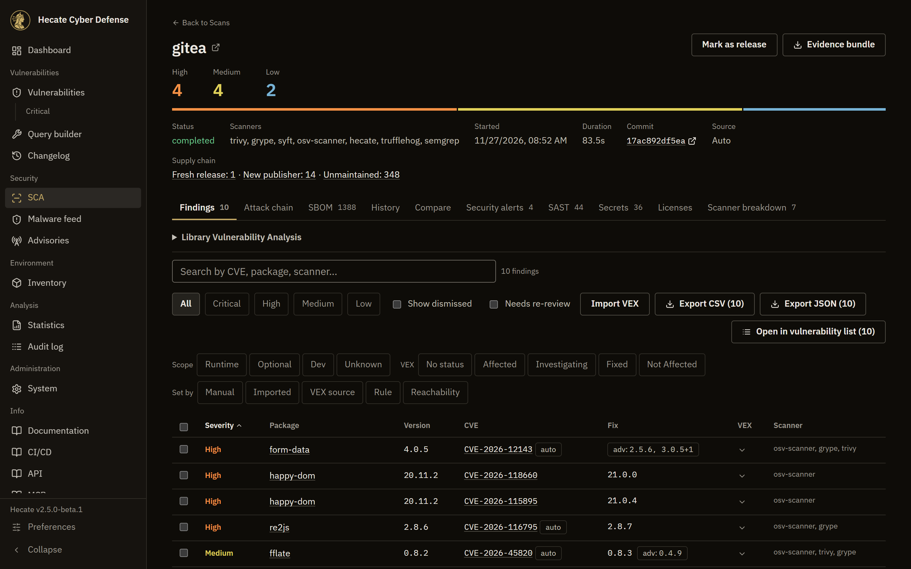
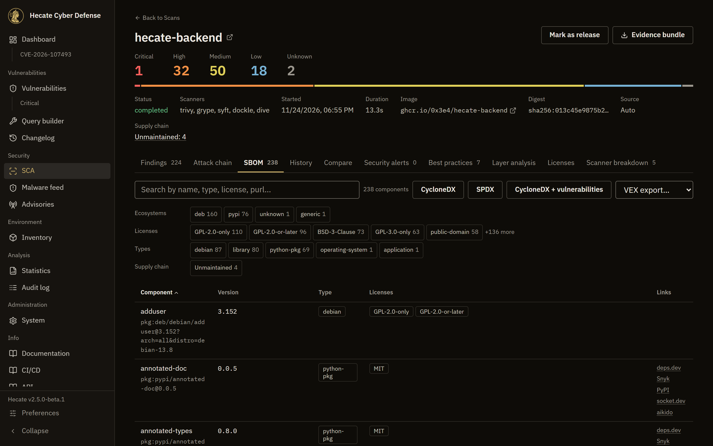
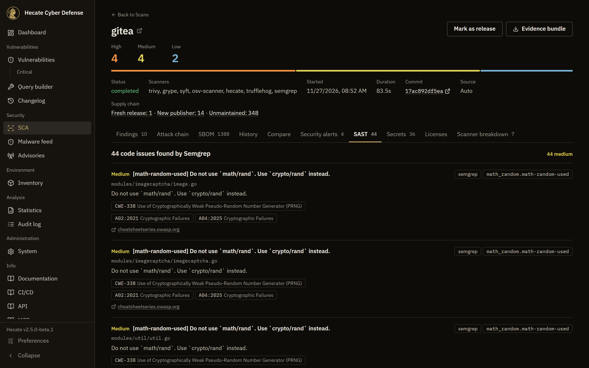
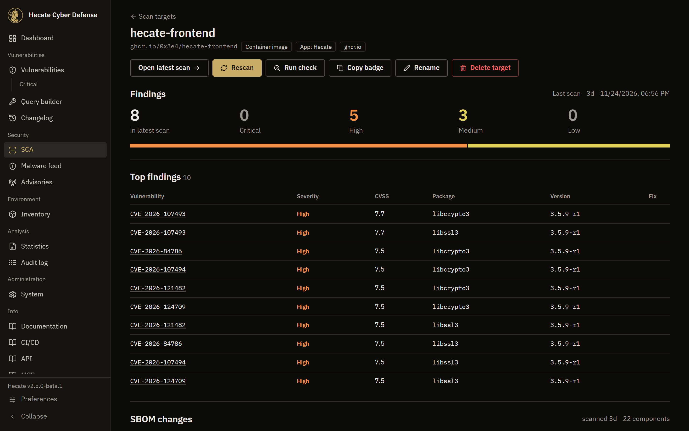

# Reading Scan Results

A finished scan is not a single number — it is a layered report. One run of the scanner sidecar can
produce a software bill of materials, a list of known vulnerabilities matched against that inventory,
malicious-package alerts, secrets that leaked into the source tree, static-analysis findings, container
best-practice checks, image-layer breakdowns and a license-compliance verdict — all bound to one
target at one point in time. This page explains how to read that report, tab by tab, and how to use the
features that let you triage findings without losing your annotations on the next rescan.

Every scan lives at `/scans/:scanId`. The header shows the target name (with a link out to the source
repository or registry), the scan status, which scanners ran, when it started and how long it took, the
commit SHA or image digest that was scanned, and a severity summary bar. While a scan is still running
the page polls itself every few seconds and streams partial results in, so you can start reading before
it finishes. To get there, open the **SCA Scans** page, pick a target or a scan, or follow **View latest
scan** from a target's overview page.

For how scans are configured and triggered in the first place, see [SCA Scanning](../sca-scanning.md).

## What a scan produces

The severity bar at the top counts **distinct vulnerabilities, not rows**. The same CVE found in three
packages from the same base image counts once, and when different packages report different severities
for it, the highest wins. That keeps the headline number honest — a CVE in `busybox`, `busybox-binsh`
and `ssl_client` is one problem to fix, not three. The findings table below still shows every per-package
row so you can see exactly where a vulnerability lands, and the badge on the Findings tab reflects that
row count.

Below the severity bar, library vulnerabilities are plotted as a bubble chart so you can see the shape of
the risk at a glance before drilling into the tabs.

## The tabs

The scan-detail page is organised into tabs that appear in a fixed order. Several of them only show up when
they have something to display — the SAST, Secrets and Licenses tabs are hidden until a scanner produced
the relevant findings, and Best Practices and Layer Analysis only appear for container-image scans.

| Tab | What it shows |
| --- | --- |
| **Findings** | Known vulnerabilities (CVE / GHSA / OSV) matched against the SBOM, merged per `(CVE, package)`, with severity, fix version, the scanners that reported each row, and VEX status. |
| **Attack Chain** | A single cross-CVE attacker narrative for the whole scan, bucketed into ATT&CK kill-chain stages. See [Attack Chains](attack-chain.md). |
| **SBOM** | Every software component the scan catalogued, consolidated by name and version, with ecosystem, license, type and provenance. |
| **History** | This target's previous scans over time, with a trend chart and a table of significant severity changes between consecutive runs. |
| **AI Analysis** | Optional AI-generated triage of the scan, kept as a timeline of analyses. |
| **Compare** | A diff of this scan against another completed scan of the same target — added, removed and changed findings. |
| **Security Alerts** | Malicious-package indicators (Hecate's malware rules plus retroactive `MAL-*` hits). See [Malware Detection & Feed](malware.md). |
| **SAST** | Static-analysis findings from Semgrep and DevSkim (source repositories only), with CWE/OWASP chips and code snippets. |
| **Secrets** | Secrets discovered by TruffleHog (source repositories only), flagged verified or unverified. |
| **Best Practices** | Dockle CIS Docker Benchmark checks (container images only). |
| **Layer Analysis** | Dive per-layer image breakdown — command, size and digest per layer (container images only). |
| **License Compliance** | The scan's components evaluated against your license policy. See [Licenses](licenses.md). |
| **Scanner Breakdown** | A per-scanner audit: which scanner ran, whether it succeeded, how many findings and SBOM rows it contributed. |

### Findings

The Findings tab is where most triage happens. Rows are merged so that the same vulnerability in the same
package version appears once even when several scanners report it, and the scanners that agreed are listed
in the row. A search box filters by CVE, package, version, scanner or fix version, and a row of severity
pills (All / Critical / High / Medium / Low) narrows the list further. Clicking a column header sorts by it;
the **VEX** column sorts by urgency: Affected, Investigating, no status, Fixed, Not Affected.

Below them, three groups of toggle buttons filter on what the finding *is* rather than how bad it is. Each
group accepts several values, an empty group means all, and your choice is remembered in the browser like
"Show dismissed":

- **Scope**: Runtime / Optional / Dev / Unknown, the [dependency scope](#dependency-scope) of the package.
- **VEX**: No status / Affected / Investigating / Fixed / Not Affected.
- **Set by**: who is behind the status: Manual (the web UI, an MCP client, or carried forward from the
  previous scan), Imported (**Import VEX**), VEX source, Rule (an [automatic VEX rule](../admin/system.md#vex-rules))
  or Reachability (an automated reachability analysis such as govulncheck).

The **Needs re-review** checkbox next to "Show dismissed" keeps only statuses whose
[review evidence](#review-evidence) is stale. **Clear filters** resets the three groups and the checkbox.

A package that is a development or optional dependency carries a small **dev** / **optional** chip after its
name.

Click a package name to expand a **detail row** with the source path, package type, CVSS score, data source,
title and advisory links. Each finding also carries a links column to the most useful external references —
deps.dev, Snyk, the package registry, socket.dev, bundlephobia and npmgraph — so you can pivot straight to
the upstream source. Findings with a CVE expose a **Show attack path** button that renders the structural
chain for that single vulnerability inline.

The Fix column shows the scanner's recommended fix version. When the advisory in Hecate's vulnerability
database also lists explicit unaffected or patched versions for the package, they appear next to it as a
teal **`adv:`** chip — so you still get a remediation target even when the scanner itself reported no fix.
This hint is read live from the vulnerability database, so it stays current as advisories are enriched,
without needing to re-scan.

A checkbox on every row plus a "select all visible" header turns on a sticky multi-select toolbar. From there
you can apply a VEX status (with an optional re-review date) to the whole selection at once, or dismiss and
restore findings in bulk. There is
also a button to open every CVE in the current view as a single query on the Vulnerabilities page.

### SBOM

The SBOM tab lists every component the scan catalogued, **consolidated server-side by name and version** — when
seven scanners all report `lodash@4.17.21`, you see it once. The columns are sortable by clicking the header,
and three clickable summary cards at the top (ecosystem, license, type) act as quick filters. A search box
trims the list, and a "Load more" pager loads the next page in 500-component steps for large bills of materials.

When a lockfile or manifest said so, a **Scope** column shows whether a component is a runtime, optional or dev
dependency, and an "All scopes" select filters on it (see [Dependency scope](#dependency-scope)).

When provenance data is available, a **provenance column** marks each component as verified, unverified or unknown,
and a dropdown filter lets you isolate one of those states. Provenance reflects whether Hecate could confirm a
build attestation or signature for the package from its registry — a verified component carries a checkmark with
the attestation type; unverified means the registry returned no usable attestation, and unknown means the version
could not be checked.

Shortly after the scan, registry lookups add **supply-chain signals**: chips under the component name for a
**Fresh release** (published within `SCA_FRESH_RELEASE_DAYS`, default 7 days), a **New publisher** (npm: the
version came from an account that published none of the versions before it) and **Unmaintained** (no release for
`SCA_UNMAINTAINED_DAYS`, default two years). The tooltip says what the registry data shows (age, the previous
publishers, the latest release), a **Supply chain** row among the summary cards filters by them, and the scan
header counts them; a click there opens the SBOM tab filtered to that signal. See
[Supply-chain signals](../sca-scanning.md#supply-chain-signals).

Two export buttons produce a standards-compliant bill of materials: **CycloneDX 1.5** and **SPDX 2.3** JSON. Next to
them, the **VEX export** select writes the scan's VEX statements in one of three formats (see
[Exporting VEX](#exporting-vex)).

### SAST, Secrets and Best Practices

These tabs separate the non-CVE findings into purpose-built views. **SAST** collects static-analysis results from
Semgrep and DevSkim — each card shows the CWE and OWASP classifications, the offending code snippet and reference
links. **Secrets** lists what TruffleHog found in a source tree, with a badge distinguishing verified secrets
(a live credential was confirmed) from unverified candidates. Findings are public, so a secret of 20
or more characters shows only its last four, anything shorter shows `***`; findings from before 2.0
keep the old form until the next scan. **Best Practices** surfaces Dockle's CIS Docker
Benchmark checks for container images. None of these count toward the vulnerability severity total — they are
reported in their own tabs with their own breakdowns.

### History, Compare and Scanner Breakdown

The **History** tab charts this target's past scans, with a 7-day / 30-day / 90-day / All range selector and a
table that highlights only the runs where severity counts actually changed. **Compare** lets you diff the current
scan against any other completed scan of the same target and shows what was added, removed or changed. **Scanner
Breakdown** is the audit trail: one row per requested scanner with its status (ok / empty / error), how many
findings it produced by severity, and how many SBOM rows it contributed — useful when one scanner timed out or
returned nothing and you want to know which.

## VEX status

VEX (Vulnerability Exploitability Exchange) is how you record your *judgement* about a finding rather than just
its raw severity. A scanner tells you a CVE is present in a package; VEX lets you state whether it actually affects
your software, and why. Hecate supports four statuses:

- **Not Affected** — the vulnerable code path is not reachable or the issue does not apply.
- **Affected** — confirmed to affect this software.
- **Fixed** — already remediated in this build.
- **Investigating** — under active assessment.

For Go source repositories, the **govulncheck** scanner sets **Not Affected** by itself where the vulnerable
package is imported but no vulnerable function is reachable (or the package isn't imported at all); such a status
shows a **reachability** chip with the reason in its tooltip and never replaces one you set. See
[Go reachability](../sca-scanning.md#go-reachability-govulncheck).

To set a status, click the VEX badge on a finding row. An editor opens below the row where you choose the status,
add an optional justification, and write a free-text detail note. Save applies it to all raw findings behind that
merged row. To annotate many findings at once, select them with the row checkboxes and use **Apply VEX** in the
multi-select toolbar.

You can also bring annotations in and out as files. **Import VEX** in the Findings toolbar reads a CycloneDX VEX
or OpenVEX document (the format is detected) and applies its statuses to the matching findings on all scans of the
target. An imported status replaces the one a finding had, and a VEX source never overwrites it. OpenVEX statements
are matched by vulnerability and its aliases; where a document gives one vulnerability different statuses for
different packages, each statement only reaches the packages its `subcomponents` (or product purl) name. The toast
reports how many findings were set, how many statements were skipped (unknown status, or a conflicting one without
a package) and how many matched nothing. The VEX export on the SBOM tab writes your current
annotations back out as CycloneDX VEX, OpenVEX or CSAF — so a VEX statement made once can travel across tools and teams.

A status set by an [automatic VEX rule](../admin/system.md#vex-rules) carries a **rule: name** chip next to
it that links to the rule on System → Policies.

### Review evidence

When a person sets a status (in the editor, the bulk toolbar or through an MCP client), Hecate records who set it
(`vexUpdatedBy`), when, and the **package version it was assessed at**. The editor and the bulk toolbar also take
an optional **re-review by** date. On the next scan the status is carried forward as usual, but when the
package moved to another version since the assessment, the row shows a **version changed** chip with the old
and new version, for example `4.17.20 → 4.17.21`. A re-review date in the past shows **review due** instead.
Both are what the **Needs re-review** filter finds. Opening the editor and saving the status again confirms it
for the current version: the flag clears and the assessed version moves on.

Imported statuses, VEX sources, rules and reachability analysis are not a person's assessment, so they record
no assessed version and are never flagged; statuses set before this existed use the version of the finding they
were set on. The CycloneDX VEX export carries the actor, assessed version and re-review date as
`hecate:vex:*` properties, the findings CSV/JSON export as columns.

The import matches by vulnerability ID across all scans of the target. It stores `analysis.justification` as the
short reason the findings table shows and `analysis.detail` in full in the editor's detail field. The export uses
CycloneDX's own vocabulary: **Affected** becomes `exploitable`, **Investigating** becomes `in_triage`, and each
affected version carries `affected`, `unaffected` or `unknown`.

### Exporting VEX

The **VEX export** select on the SBOM tab (and `GET /api/v1/scans/{scanId}/vex/export?format=…`) offers three
formats:

| Format | `format=` | What it holds |
| --- | --- | --- |
| CycloneDX 1.5 VEX | `cyclonedx` (default) | The findings that carry a VEX status. Unchanged from earlier versions. |
| OpenVEX 0.2.0 | `openvex` | One statement per vulnerability and package. The product is the scan target (`pkg:oci/…` with the digest for an image, the repository URL for a source repo), the package purl from the SBOM is its subcomponent. |
| CSAF 2.0, profile VEX | `csaf` | `document.category = csaf_vex`. The product tree lists the target and every affected package (with its purl), each package as `default_component_of` the target; statuses refer to that relationship product. |

OpenVEX and CSAF list **every** vulnerability finding of the scan, not only assessed ones: a finding nobody has
assessed yet is `under_investigation`. Hecate knows the package carries the advisory but nobody has said whether
it matters, so `known_affected` would be a claim nobody made and leaving it out would read as "not mentioned".
SAST, secret and compliance findings carry no advisory ID and are not VEX statements.

How the fields map:

- **Justification.** OpenVEX and CSAF share five labels (`component_not_present`, `vulnerable_code_not_present`,
  `vulnerable_code_not_in_execute_path`, `vulnerable_code_cannot_be_controlled_by_adversary`,
  `inline_mitigations_already_exist`). A justification that is one of them, a CycloneDX justification (mapped as in
  CISA's table, e.g. `code_not_reachable` → `vulnerable_code_not_in_execute_path`) or the same words with spaces
  becomes the OpenVEX `justification` / CSAF flag. Free text becomes the OpenVEX `impact_statement` / a CSAF
  `impact` threat, since both formats require one or the other for *not affected*.
- **Affected.** OpenVEX gets an `action_statement`, CSAF a remediation: `vendor_fix` when a fix version is known
  ("Update … to …"), `no_fix_planned` / `workaround` from the CycloneDX response, otherwise `none_available`.
- **Review evidence.** The version a statement was assessed against and its re-review date go to the OpenVEX
  `status_notes`, a CSAF `details` note on the vulnerability and CycloneDX `properties`.
- **CSAF tracking.** Each export is a snapshot: the tracking ID is `HECATE-VEX-<scan>-<time>`, status `final`,
  version `1`, and the file is named after the tracking ID as CSAF asks. The publisher comes from
  `CSAF_PUBLISHER_NAME`, `CSAF_PUBLISHER_NAMESPACE`, `CSAF_PUBLISHER_CATEGORY` (default `vendor`) and the optional
  `CSAF_PUBLISHER_CONTACT`; set them to your organisation, the defaults (`Hecate`, `https://hecate.invalid`) mark an
  unconfigured instance. OpenVEX uses the same name as `author`.

An OpenVEX export can be imported again (into the same or another target) with **Import VEX**.

## Releases and the evidence bundle

The EU Cyber Resilience Act expects a manufacturer to keep the SBOM and the vulnerability handling of every release
for years. Hecate never deletes scans on its own: there is no retention job and no expiry, and scans, findings and
SBOM rows only go when an admin deletes a scan or a whole target.

**Mark as release** in the header of a completed scan gives it a version label (`1.4.2`, at most 64 characters,
unique per target) and an optional note. The marker needs the target's write password (or the system password),
like any other write on the target; **Edit release** renames it or removes the marker. A release scan cannot be
deleted on its own while it carries the marker: remove the marker first. Deleting the whole target still removes
everything, releases included. The target page lists its releases with label, scan date, findings, commit or image
digest and note, each linking to the scan.

**Evidence bundle** (next to the release marker, or `GET /api/v1/scans/{scanId}/evidence-bundle`) downloads one ZIP
for any scan:

| File | Content |
| --- | --- |
| `sbom/<name>.cdx.json`, `sbom/<name>.spdx.json` | The SBOM in CycloneDX 1.5 and SPDX 2.3 |
| `vex/vex.cdx.json`, `vex/vex.openvex.json`, `vex/hecate-vex-….json` | VEX in CycloneDX, OpenVEX and CSAF 2.0 |
| `findings-summary.json` | Severity counts, VEX status counts (unassessed counted apart), counts of SAST / secret / compliance / malware findings, one row per vulnerability finding |
| `manifest.json` | Target, scan ID, commit / image digest, scanners, release label and note, generation time, and the SHA-256 and size of every other file |
| `SHA256SUMS` | The same hashes, for `sha256sum -c SHA256SUMS` |

A format with nothing to state (CycloneDX VEX before any finding is assessed) is listed under `omitted` in the
manifest instead of being written empty. The bundle is built in memory and refused above 200 MB of content.

### VEX sources

When the vendor of an image publishes a VEX document for it, you don't have to import it after every scan. On the
target page, **VEX sources → Add source** takes up to five https URLs of CycloneDX VEX or OpenVEX documents. Hecate
fetches them right away and again after every scan and SBOM import, and sets the status of the matching findings
on all scans of the target. **Apply now** fetches them again on demand.

- Your own word stays on top: a source only sets findings that have no VEX status yet or one that came from a
  source. A status you set by hand or imported is never overwritten, and it survives later scans.
- When a source stops mentioning a vulnerability, the status it set is removed again, but only if every source
  could be read; a failed fetch never removes anything.
- If the documents give one vulnerability different statuses for different packages, each statement only reaches
  the packages it names.
- Like the manual import, a statement is matched by vulnerability and package name, not by package version, so it
  still applies after the package was updated. Keep sources the vendor maintains, not frozen copies.
- The card shows per source what the last fetch found (format and number of statements, or why it failed) and
  how many findings were set or removed.
- A `github.com/…/blob/…` link is turned into its raw file. URLs with credentials, plain http and hosts that
  resolve to private addresses are refused (see [Security & Access Control](../security-access-control.md)).

Hecate publishes VEX documents for its own images, so a scan of `ghcr.io/0x3e4/hecate-backend` with
`https://raw.githubusercontent.com/0x3e4/hecate/main/vex/hecate-backend.openvex.json` as its source shows how it
works. See [VEX for Hecate's images](../admin/vex.md).

!!! note "VEX files in the scanned repository"
    A scan does not read VEX files committed to the scanned repository: the repository could otherwise mark its
    own findings `not_affected`. To use a file you keep next to the code, add its raw URL as a VEX source, for
    example `https://raw.githubusercontent.com/<owner>/<repo>/main/vex/app.openvex.json` (a
    `github.com/…/blob/…` link works too). It is then read again after every scan, so the next commit to the file
    reaches the findings on its own.

Over MCP, `set_finding_vex`, `import_vex`, `set_target_vex_sources` and their siblings do the same from an
assistant; see [MCP Server](../integrations/mcp.md).

## Dependency scope

Hecate's own analyzer reads the scope of every package where the source states it, and keeps a small vocabulary:
**runtime**, **optional**, **dev** (development, test and build tooling) or unknown.

| Source | What it reads |
| --- | --- |
| `package-lock.json` | `dev` → dev, `optional` / `devOptional` → optional, otherwise runtime |
| `pnpm-lock.yaml` | the `dev` / `optional` flags (v5/v6); in v9 the importers' `dependencies` / `optionalDependencies` / `devDependencies`, followed through `snapshots` |
| `yarn.lock` (classic and Berry), `bun.lock` | no flags in the file: the direct dependencies of the `package.json` files next to it (or the bun workspaces), followed through the lockfile's dependency graph |
| `package.json` without a lockfile | `dependencies` / `optionalDependencies` / `devDependencies` |
| `poetry.lock` | `groups` (main → runtime, any other group → dev) or the older `category`; `optional = true` in main → optional |
| `uv.lock` | the workspace member's `dependencies` (runtime), `optional-dependencies` (optional) and `dev-dependencies` (dev), followed through the graph |
| `Pipfile.lock`, `Pipfile` | `default` / `packages` → runtime, `develop` / `dev-packages` → dev |
| `pyproject.toml` | PEP 621 dependencies → runtime, optional-dependencies → optional, PEP 735 dependency-groups and Poetry dev groups → dev |
| `composer.lock` / `composer.json` | `packages` / `require` → runtime, `packages-dev` / `require-dev` → dev |
| `pom.xml` | `<scope>test</scope>` → dev, `<optional>true</optional>` → optional, compile / runtime / provided / system → runtime |
| `gradle.lockfile`, `build.gradle(.kts)` | test and tooling configurations (`test*`, `*Test*`, annotationProcessor, kapt, detekt, …) → dev, others → runtime |
| `*.csproj`, `packages.config` | `PrivateAssets="all"`, `developmentDependency="true"` or a test project (`IsTestProject`, `Microsoft.NET.Test.Sdk`) → dev |
| `Cargo.toml`, `pubspec.yaml` / `pubspec.lock` | dev- and build-dependencies → dev; pubspec.lock's `direct main` / `direct dev` |
| CycloneDX from other scanners or an imported SBOM | `scope`: required → runtime, optional → optional, excluded → dev |
| Trivy | a package flagged `Dev` → dev |

A transitive package reached from a runtime dependency stays runtime even when a dev dependency also pulls it in.
When several files or scanners disagree about the same name and version, **runtime wins over optional, optional
over dev, and unknown never overrides a known value**: a scope can hide a finding from a filter or let a rule mark
it, so the conservative answer wins. After the scan the merged scope is written to every SBOM row of that
component and to the findings in it (matched by package name and version, else by name), within the finding's
ecosystem only: an npm dev dependency `dummy-lib` never marks a PyPI `dummy_lib` finding dev. Container images mostly
stay unknown: what the image installed is what runs.

Development dependencies are not hidden by default. Filter them out on the Findings tab, or let an
[automatic VEX rule](../admin/system.md#vex-rules) mark them.

## Dismissing findings

Dismissal is separate from VEX. Where VEX is a published, exportable statement about exploitability, **dismissal is a
personal display filter** — a way to push noise out of view without claiming anything about the vulnerability. Dismissed
findings are hidden by default; tick **Show dismissed** in the Findings toolbar to bring them back, rendered dimmed with
a "dismissed" badge. Dismiss and restore are available per finding through the multi-select toolbar, optionally with a
reason.

!!! tip "Annotations survive rescans"
    Both VEX statuses and dismissal flags are **carried forward** to the next scan of the same target automatically.
    Matching is on the vulnerability ID plus package name (falling back to title plus package for findings without a
    CVE), so the work you put into triaging one scan is not lost the moment the target is scanned again.

## Exporting findings

**Export CSV** and **Export JSON** in the Findings toolbar download the vulnerability findings of this scan. With
rows ticked, only those are exported; with none ticked, every row the current search, severity, scope and VEX filters and
**Show dismissed** setting shows. The count on the button says how many rows the file will hold. One row is one
merged finding (vulnerability + package + version across scanners), as in the table.

Both formats carry the vulnerability ID, severity, CVSS score, package name, version, type and path, fix version
and fix state, the advisory's fixed versions, title, description, scanners, data source, dependency scope,
who set the VEX status, the assessed version, the re-review date and the needs-review flag, VEX status with
justification and detail, the dismissal flag and reason, and the reference URLs. The JSON file adds a `metadata`
block (export time, `scope` = `selected` or `filtered`, target, image or commit, scan times) and the raw finding IDs
behind each row. The CSV is UTF-8 with a BOM so Excel shows umlauts correctly; a value that starts with `=`, `+`,
`-` or `@` gets a leading `'`, because package names and titles come from the scanned code and a spreadsheet would
otherwise run them as a formula.

The export covers the Findings tab only; malware alerts, SAST, secrets and best-practice checks stay in their own
tabs. For a standards format use the CycloneDX / SPDX SBOM and the VEX export on the SBOM tab, or the
[evidence bundle](#releases-and-the-evidence-bundle) for all of them at once.

## The target overview page

Each registered target also has its own overview page at `/scans/targets/<target-url>`, reachable by clicking a target
row on the SCA Scans page. The page is deep-linkable even with hand-typed URLs: pasting the target's repository or
image URL after `/scans/targets/` works un-encoded and without the `https://` scheme — the backend resolves such
variants to the registered target automatically. Where the scan-detail page is about one run, the target page is about the asset over time.
It shows the target's metadata (type, application group, registry, auto-scan state and the configured scanners), the
severity rollup of its latest scan, and — when auto-scan is enabled — the last change-detection check with its verdict
and any error, so you can see why an automatic rescan did or did not fire.

The way into the latest scan sits at the top: **Open latest scan** is the first button in the header, the severity figures open the latest scan with its findings filtered to that severity (the total opens it unfiltered), and a **Scan running** chip opens the scan in progress. In the scan history, the date of a row opens that scan too.

Below that, a **Top findings** list summarises the worst of the latest scan, and an **SBOM changes** card sits
alongside it (stacked on narrower screens) showing how the target's software bill of materials last shifted —
components **added**, **updated** (with the old → new version), and **removed** — headed by the changed scan's time
and commit short-hash so you can tie a dependency change to a specific commit. If the target has had several
unchanged rescans in a row, the card looks back through its history to the last scan that actually changed something
and says so, rather than reporting "no changes" just because the most recent run happened to match its predecessor.
A target with only one completed scan shows a baseline line instead. A **Releases** list shows the scans marked as
releases (see [Releases and the evidence bundle](#releases-and-the-evidence-bundle)). A paginated **Scan history** table lists every
completed run with a link into each. Quick-action buttons let you trigger a rescan, run a change-detection check on
demand, copy a shields.io status badge for your README, or delete the target and all its data — a dialog asks first,
and deleting removes the target from the list immediately, while its scan history is cleaned up in the background.
When a target is write-protected, a lock badge appears next to its name, the action buttons require the appropriate
password, and **Change password** lets the owner replace or remove it —
see [Security & Access Control](../security-access-control.md). SBOM-import targets are read-only and do not show the
rescan, check or delete actions.

!!! note "Status badges for your README"
    The **Copy badge** button copies Markdown for a shields.io badge that always tracks the target's latest completed
    scan — drop it into a repository README to show the current severity breakdown at a glance.
